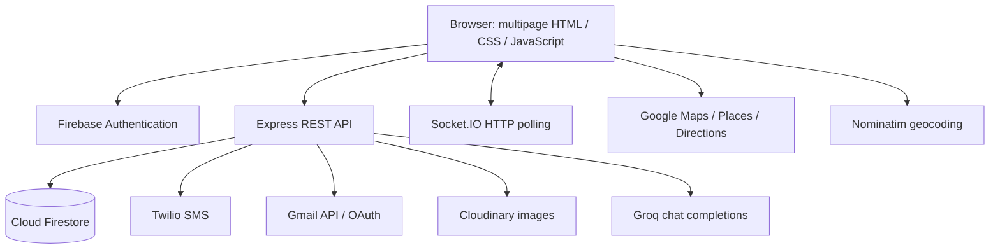

**HerShield — detailed project audit**

Working-tree snapshot: **7 October 2026**. This report describes the implementation present in the shared project, including main application code, prototypes, data files, configuration, and documentation drift.

The audit indexed **71 source/configuration files containing 26,390 lines**, including generated map HTML, and **128 project files in total** after excluding installed dependencies, Python virtual environments, Git internals, and Firebase caches. It mapped **85 main API endpoints**. These counts describe the project before the audit artifacts were added; they do not count every installed library as application code.

Evidence levels used below:

- **Implemented:** visible in the current source, but its external providers may not have been exercised.
- **Locally reproduced:** verified with the real route/function and synthetic in-memory data. No real Firebase records were changed and no notifications were sent.
- **Source finding:** follows from the inspected code; browser/provider behavior remains untested.
- **Advertised/prototype:** present in copy or a separate experiment, without an integrated implementation in the main application.

The audit did not validate production credentials, current provider account/billing status, deployed revisions, notification delivery to a handset, Firebase sign-in with a real account, camera capture on a device, or every responsive layout in a browser. Comments about earlier billing problems and hosting restrictions are historical project notes, not independently verified current provider facts. Secret values and personal record contents are deliberately excluded from the report and inventory.

**1. What the project actually is**

HerShield is a multipage women's safety web application. Its integrated features are authentication, user profiles, emergency contacts, several emergency/tracking workflows, map-based safety information, incident reporting, community posts/alerts, a Groq-powered safety/legal chat assistant, selfie submission for human review, and an administrator console.

The main frontend is **plain HTML, CSS, and JavaScript**. There is no React application build, Next.js server, TypeScript compilation, or frontend bundler in the root package. Pages share scripts but also contain substantial inline styling and logic. Express serves the pages and exposes REST routes. Firestore is the main persistent database.

The repository also contains a separate React/Leaflet hotspot experiment and Python/Folium/Streamlit/Gemini experiments. Starting the root application does not launch those components.

**2. Architecture and deployment topology**

Local mode: `npm start` launches the root server. Express serves frontend files and API calls from one origin. API URLs beginning `/api/` normally resolve to that server. The default port is 3000.

Configured production mode: Firebase Hosting serves the root frontend files, while the frontend configuration points API traffic at `https://ai-hershield.onrender.com`. The configured frontend is `https://hershield-web.web.app`. These are repository configuration values, not confirmation that the sites currently serve this exact revision.

The browser configuration wraps `window.fetch` and `XMLHttpRequest.open` on any hostname other than `localhost` or `127.0.0.1`, rewriting relative API requests to the configured Render backend. It also exposes `HERSHIELD_BACKEND` and `HERSHIELD_FRONTEND` for scripts. This means a local LAN IP or custom domain is treated as production and redirected to Render unless the code is changed. The Request-object fetch branch checks for relative paths even though `Request.url` is normally absolute, so that branch is unlikely to perform the intended rewrite.

The interceptor does not rewrite normal navigation links or script tags. This matters for the admin CSV download link and local Socket.IO client script paths described later.

Evidence: [server entry](C:/Users/mdtou/project/hackathon/server.js:1), [browser environment routing](C:/Users/mdtou/project/hackathon/config.js:1), [public URL helpers](C:/Users/mdtou/project/hackathon/config/appUrls.js:1), [Firebase hosting configuration](C:/Users/mdtou/project/hackathon/firebase.json:1).

**3. Server boot, middleware, and lifecycle**

The server loads the root `.env`, constructs Express and an HTTP server, initializes Socket.IO, installs middleware, mounts static serving and route modules, starts scheduled maintenance, and binds a port.

Middleware and operational behavior:

| Component | Current behavior |
|---|---|
| Proxy trust | Enabled in production or when `TRUST_PROXY=1`; trusts one proxy hop |
| CORS | Allows all origins, selected methods, Content-Type/Authorization, and enables credentials |
| Helmet | Enabled, but Content Security Policy and cross-origin embedder policy are disabled |
| Compression | Compresses HTTP responses |
| JSON/form parsing | Up to 10 MB each |
| Logging | Morgan development format in development, combined format otherwise |
| General API limit | Default 500 requests per 15 minutes per IP, configurable |
| Emergency/live-tracker limit | 300 requests per minute per IP |
| Admin limit | 120 requests per minute per IP |
| Admin login limit | Additional 10 requests per minute per IP plus exponential backoff |
| Legal chat limit | Default 20 messages per 10 minutes per IP |
| Error handling | Generic final-handler errors in production; several route handlers still return their own error details |
| Unknown routes | JSON 404, after static serving and API handling |
| Shutdown | SIGTERM/SIGINT close HTTP server and exit |
| Uncaught errors | Logged; process exits in production |

General limiting skips admin, emergency, and live-tracker prefixes because they have separate limits. Classic `/api/tracking` still uses the general limiter. Limits and login failure state are in process memory, so they reset on restart and are not coordinated across multiple backend instances.

Port fallback tries **3000 through 3024** by default: the upper bound is exclusive. It records the actual port in a global and `ACTIVE_PORT`, and fills `APP_URL` when it was absent. Explicit `APP_URL`/`FRONTEND_URL` values override this behavior. This is useful locally but a production port mismatch could conflict with the hosting platform's expected port.

Startup jobs restore expiry timers for active SOS records and run a selfie-retention sweep, then repeat the sweep daily. Consequently, starting the configured main server is not purely read-only. This audit used isolated route mounts rather than launching the configured server.

`/api/health` reports uptime, environment, configured Firestore/email state, port, and URL configuration. Its database health is based on successful SDK initialization, not an actual database connectivity query. HTTP status remains `ok` when services are absent. `/api/dashboard/stats` has a six-second fallback that returns zeros; the underlying database request is not cancelled by that timeout.

Evidence: [middleware and rate limits](C:/Users/mdtou/project/hackathon/server.js:32), [startup jobs](C:/Users/mdtou/project/hackathon/server.js:176), [port fallback](C:/Users/mdtou/project/hackathon/config/listenWithFallback.js:10), [database health](C:/Users/mdtou/project/hackathon/config/database.js:15).

**4. Frontend pages and responsibilities**

| Page | Responsibility and connected behavior |
|---|---|
| Landing | Marketing sections, feature cards, data-source claims, animated counters, about/map illustration, signup links, and a report modal |
| Authentication | Login, signup, password recovery, Google onboarding, account completion, and verification-related redirects |
| Dashboard | Map, counts, community incident alerts, emergency action, report form, verification banner/camera, combined SOS/tracking history, safety resources, LexaShield chat |
| Live tracker | Start/destination autocomplete, travel mode, six-digit PIN, share link, tracking map, GPS status, periodic PIN prompt, stop and emergency controls |
| Live tracker viewer | Same URL/page with `?track=` or `?code=`; constructs a full-screen viewer shell, consumes locations, provides map link |
| Safety map | Static safety points plus reported incidents, markers/circles, heatmap, day/night risk adjustment, route alternatives and safety-weight slider |
| Community | Feed, category badges, composer, image preview/upload/lightbox, optional location, likes, sharing, recent alerts, emergency resource links |
| Identity verification | Front camera capture, preview/retake, authenticated upload, rejected-submission explanation, redirect after submission |
| Admin login | Server-side admin email/password login and session token storage |
| Admin dashboard | Overview, user administration, verification queue, posts/alerts/incidents, SOS/tracking, broadcasts, activity logs, CSV safety data, SMS diagnostics, theme preference |
| Older map page | A simpler Google directions map without the current integrated safety flow |
| Older report page | Posts to `/report-incident`, which the main server does not implement |

The shared navigation script constructs a desktop sidebar, mobile sidebar/action panels, profile editing, avatar uploads, emergency contacts, and SOS controls. It also contains authentication redirect logic and local caches. At **2,106 lines**, it functions as a broad UI controller rather than just navigation.

Large page files are dashboard (2,691 lines), admin dashboard (1,998), safety map (1,551), live tracker (1,418), and landing (1,398). These figures include markup, inline CSS, comments, and scripts. Shared code and page-specific overrides can affect one another through global classes and IDs.

Evidence: [shared navigation](C:/Users/mdtou/project/hackathon/navigation.js:29), [dashboard](C:/Users/mdtou/project/hackathon/dashboard.html:1), [live tracker client](C:/Users/mdtou/project/hackathon/live-tracker.js:236), [viewer](C:/Users/mdtou/project/hackathon/live-tracker-viewer.js:1).

**5. Authentication, onboarding, and identity**

Firebase client code implements email/password registration and login, Google popup authentication, Facebook and Apple provider methods, password reset, phone OTP with reCAPTCHA, logout, and profile updates. Provider methods in code do not establish that each provider is enabled in Firebase or exposed as a complete user flow.

The browser imports Firebase Web SDK **10.7.1 from Google's CDN**. The root npm dependency is Firebase **12.6.0**, but changing that installed package does not change those browser CDN imports. Firebase browser configuration is hardcoded rather than read from the server's Firebase Web environment variables.

After sign-in, the browser calls `/api/users/upsert` using the Firebase UID as the Firestore document ID. New records contain defaults for contacts, preferences, statistics, gender self-declaration, verification state, consent, activity, and role. The upsert endpoint accepts a caller-supplied UID without verifying its Firebase token. Existence of a UID is input validation, not authentication.

Google login and signup are deliberately distinguished: a new account created during a login attempt is best-effort deleted and signed out; an existing account used in signup mode is signed out and told to log in. Google signup can optionally link an email/password credential. The global auth-state listener also synchronizes profiles, so provider creation, sync, and the best-effort rollback can race; this is a source concern requiring an end-to-end account test.

Phone-only authentication needs attention. The synchronization body sends an empty email when none exists, but the backend requires a valid email. The auth-state listener also contains a `user.email.split('@')` fallback without a null check. Phone OTP can therefore succeed at Firebase while profile synchronization or UI initialization fails.

The navigation guard trusts either Firebase state or a `hershield_logged_in` local-storage flag. It is a convenience redirect, not a security boundary. Some page paths are protected only by that client guard; API authorization has to be independent.

Admin authentication is separate: one configured admin email, a bcrypt password hash, and a signed JWT with **two-hour expiry**. The browser stores the token in **sessionStorage**, not an HttpOnly cookie. All admin routes after `/login` pass through admin JWT middleware. A built-in fallback signing secret remains if the environment variable is omitted. There is no per-admin account database, MFA, server-side token revocation list, or granular permissions in this implementation.

Evidence: [Firebase auth service](C:/Users/mdtou/project/hackathon/firebase-auth.js:42), [Firebase CDN configuration](C:/Users/mdtou/project/hackathon/firebase-config.js:1), [user upsert](C:/Users/mdtou/project/hackathon/routes/users.js:53), [navigation guard](C:/Users/mdtou/project/hackathon/navigation.js:103), [admin login](C:/Users/mdtou/project/hackathon/routes/admin.js:91), [admin token middleware](C:/Users/mdtou/project/hackathon/middleware/adminAuth.js:9).

**6. Selfie verification: the precise gate and review flow**

New accounts created through upsert receive `verificationGateRequired: true`. Older records without that field are exempt from that onboarding redirect. Legacy registration and emergency-created user stubs also do not set the same gate consistently.

After login, the auth page fetches `/api/verification/status` using a Firebase ID token. Gated users whose state is neither `pending` nor `verified` are redirected to the capture page. A failed status request falls open to the dashboard. The dashboard and APIs do not enforce approved verification server-side.

The capture page requests the front camera without audio, renders a video preview, draws a captured frame to canvas, encodes a JPEG, and sends a multipart `selfie` file with a Firebase bearer token. The backend accepts image uploads up to 10 MB, stores them in Cloudinary with authenticated delivery, sets the user state to `pending`, and stores the image identifier and submission date.

**Submission satisfies the onboarding step; approval is not required to enter the dashboard.** `pending` and `verified` both redirect to it. The user can still view a pending/rejected/verified banner on the dashboard. This corrects the earlier description that verification was entirely informational: there is now a submission redirect for some new accounts, but it remains a client-side onboarding gate.

An admin can view the selfie through an authenticated backend streaming route, approve it, or reject it with a reason and optional account deactivation. This is **manual review**, not facial recognition, identity-document verification, gender classification, or liveness detection. The API accepts a file regardless of whether the frontend captured it live.

The retention job deletes selfies older than 90 days and clears the pointer while preserving verification status. Two limitations: it requests 5,000 users but the repository caps the query at **1,000**, and Cloudinary deletion errors are swallowed before the pointer is cleared. Thus the sweep can miss users or lose the pointer to an undeleted image. Both matter more as the dataset grows.

The rejection-email helper is imported in the admin module but is not called by the reject route. Welcome, approval, and deactivation emails do have call sites.

Evidence: [post-login redirect](C:/Users/mdtou/project/hackathon/auth.html:609), [capture page](C:/Users/mdtou/project/hackathon/verify-identity.html:252), [submission API](C:/Users/mdtou/project/hackathon/routes/verification.js:51), [review routes](C:/Users/mdtou/project/hackathon/routes/admin.js:301), [retention](C:/Users/mdtou/project/hackathon/services/verificationRetention.js:35), [repository cap](C:/Users/mdtou/project/hackathon/services/firestoreRepository.js:634).

**7. User profiles, contacts, and browser caches**

Profiles contain name, email, phone, picture, age, home address, blood group, allergies, medications, preferences, consent fields, statistics, and verification metadata. Profile updates whitelist fields but do not authenticate ownership. The profile GET returns the entire user record, including contacts and sensitive profile fields.

Avatar upload is token-protected and sends a memory-buffered image to public Cloudinary storage. It returns the image URL; the browser then saves the URL through the profile endpoint. This two-step operation can leave an uploaded but unreferenced image if the second request fails. There is no automatic cleanup of old avatars or deleted post images.

Emergency contacts accept a name and at least one email/phone, plus relationship and priority. Phone numbers are normalized and marked with `phoneValid`; invalid supplied numbers may still be stored. Contact creation auto-creates a user stub if necessary. Contact read, add, and delete routes accept caller-supplied IDs without authentication. There is no documented maximum contact count or transaction around whole-user contact updates.

Avatar cache entries are tagged with an owning account, and extended profile caching has an owner marker. Other caches include contacts, active SOS state, and live-tracker sessions. Logout does not clear every safety-related cache: notably contacts, `safetyTrackerSession`, and active SOS state are not all removed in the Firebase logout method. The tracker cache includes its PIN in plaintext and is not clearly tied to the currently authenticated account. Account switching on one browser needs explicit testing.

Evidence: [profile routes](C:/Users/mdtou/project/hackathon/routes/users.js:225), [avatar upload](C:/Users/mdtou/project/hackathon/routes/users.js:347), [contacts](C:/Users/mdtou/project/hackathon/routes/emergencyLite.js:509), [logout cleanup](C:/Users/mdtou/project/hackathon/firebase-auth.js:501), [tracker cache](C:/Users/mdtou/project/hackathon/live-tracker.js:500).

**8. Three tracking mechanisms and four emergency actions**

| Flow | Identity/key | PIN | Persistence and purpose |
|---|---|---|---|
| Classic tracking API | Separate session ID, linked to user ID | None for ending | Trip lifecycle, current location, history, check-ins, duration, stats |
| Live-tracker page | Generated timestamp/random session ID in a field named `userId` | UI: six digits; API: 4–10 characters | Periodic browser safety checks, shareable viewer, emails |
| Shared-navigation SOS | Firebase user ID used as live-session key | Four numeric digits, SHA-256 hash | SOS event plus paired live session, optional auto-stop, contact alerts |

The separate emergency actions are: shared-navigation PIN-based SOS; dashboard point-in-time alert; classic `/api/emergency/trigger`; and the live-tracker missed-PIN/manual alert endpoint. They do not have identical notification behavior, history semantics, or state transitions.

Classic tracking creates a unique six-character code by checking the classic collection, increments total trips, records location updates/check-ins, and marks a session completed on `/end`. Duration is calculated in seconds. Distance starts at zero and no distance accumulation was found. Ending an already completed session is not explicitly rejected, so repeated calls can increment safe-trip counts repeatedly. Location/check-in arrays are not bounded like the newer live-tracker logs. The share link points at the newer viewer, which resolves codes against a different collection; classic share links can therefore fail to resolve.

The live-tracker page collects source, destination, travel mode, six-digit PIN, and saved contact emails. It creates a generated session ID rather than using the signed-in Firebase UID. Contact phone numbers are not passed into this flow. Start sends a tracking email when configured, but email failure does not undo session creation. The API accepts an empty emergency-contact list even though the UI blocks it.

GPS uses `watchPosition` with high accuracy. The client rejects fixes worse than **2,000 metres**, and the backend repeats this check when an accuracy value is present. The client also rejects jumps over 2 km implying more than 300 km/h when the new fix is worse than 300 metres. Warnings are throttled for about a minute. Location updates have no explicit request debounce and do not inspect non-2xx responses after `fetch`, so failed server updates can be missed by the UI.

Accepted locations are appended transactionally to a Firestore array capped at **2,000 entries**. Each update rewrites that array. The repository stores latitude, longitude, and timestamp, but drops accuracy; viewer polling consequently falls back to an inaccurate default of 50 metres even when the client submitted 450 metres. Socket broadcasts preserve accuracy for that event, so socket and polling viewers can disagree.

The client starts a countdown from the server-provided verification interval. Default: **120,000 ms** between PIN checks and **20,000 ms** to respond. Render's configuration overrides the interval to **600,000 ms**. An incorrect PIN shows an error and leaves the response timeout running; the timeout can invoke the emergency alert flow if the modal remains open. The countdown and alert initiation run in the browser: a closed page, suspended mobile tab, sleeping device, or lost network can prevent the alert. There is no server watchdog scanning stale `lastVerified` values.

The PIN confirmation also has a network-failure gap: after a locally matching PIN, the backend request's catch block ignores network/parsing failures, then clears the timeout, closes the modal, displays “Safety Confirmed,” and resets the timer. A server response explicitly reporting failure is handled, but an exception is treated as confirmation. The toast always says the next check is in two minutes even when the server configured ten minutes. Evidence: [PIN confirmation](C:/Users/mdtou/project/hackathon/live-tracker.js:702).

Session restoration uses localStorage and discards entries older than 24 hours. It does not establish server-side activity before resuming its local state. The PIN is stored in plaintext in both the browser cache and normal live-session documents. Verify/stop compare it directly. SOS live sessions instead store a hash in the same `pin` field, while their dedicated safe endpoint compares a separate `pinHash`; these are incompatible representations within one collection.

Evidence: [classic tracking](C:/Users/mdtou/project/hackathon/routes/trackingLite.js:26), [live start](C:/Users/mdtou/project/hackathon/routes/liveTracker.js:81), [GPS filtering](C:/Users/mdtou/project/hackathon/live-tracker.js:556), [PIN timers](C:/Users/mdtou/project/hackathon/live-tracker.js:670), [location persistence](C:/Users/mdtou/project/hackathon/services/firestoreRepository.js:374).

**9. SOS lifecycle and delivery semantics**

The shared-navigation SOS flow gets a four-digit PIN, location, and optional timer. The server loads or creates the user, expires any existing active SOS, creates a live session keyed by user ID, writes an SOS event, increments alert statistics, schedules expiry, and attempts contact notifications.

SOS states are `active`, `safe`, and `expired`. Mark-safe checks the PIN hash, clears the local timer, updates the event, stops the live session, and attempts safe SMS confirmations to the user and contacts. It intentionally does not send a safe email. Expiry stops tracking and marks expired; it does not establish that the person is safe or send an escalation notification. An expired event's stored resolution time means expiry, not a verified safe outcome.

The browser pushes SOS locations every **10 seconds**. On GPS acquisition failure, it currently sends **latitude 0, longitude 0**, while the UI message says it used the last known position. This is a concrete incorrect-location fallback. This SOS helper also omits accuracy from updates, bypassing the newer flow's accuracy threshold. Server-side reverse geocoding is best-effort but awaited and has no explicit timeout.

The SOS code generator checks code collisions in the classic tracking collection rather than the live-session collection it writes to. It uses `Math.random`, and after ten attempts it can return a code without ensuring uniqueness. The normal live-tracker code generator does not check collisions at all. The check/write sequence in classic tracking is also not atomic.

The dashboard alert merges contact emails from the request and Firestore, falls back to the user's email, sends SMS to stored phone contacts, and attempts email. It stores a point-in-time SOS-history event with `status: 'safe'` and immediate `resolvedAt`, even though that action itself does not confirm safety. Its outer response says success with per-channel counts even if no notification was delivered. This differs from live-tracker `/trigger-alert`, which awaits email and exposes failure in its `success` field.

SOS-history endpoints return event records without authentication, including contact metadata and PIN hashes. The live-tracker history endpoint does omit PINs, but still exposes journey/session metadata by email without checking ownership. PIN hashes for a four-digit value do not provide much protection if exposed because the value space is small.

Evidence: [SOS creation](C:/Users/mdtou/project/hackathon/routes/emergencyLite.js:157), [safe confirmation](C:/Users/mdtou/project/hackathon/routes/emergencyLite.js:326), [GPS fallback](C:/Users/mdtou/project/hackathon/navigation.js:1530), [dashboard alert](C:/Users/mdtou/project/hackathon/routes/liveTracker.js:395), [history mapping](C:/Users/mdtou/project/hackathon/routes/liveTracker.js:622).

**10. Viewer behavior and realtime events**

The viewer recognizes `?track=<sessionId>` directly or resolves `?code=<trackingCode>` through the API. It hides the tracker UI, constructs a fixed full-screen shell, subscribes to a Socket.IO session room, and polls the latest location every 10 seconds as a fallback. Coordinates, update time, a Google Maps link, marker, and accuracy circle are displayed.

The server's Socket.IO transport is **HTTP polling only**. Comments referring generally to WebSocket upgrades do not describe this configuration. It uses 60-second ping timeout, 25-second ping interval, and accepts older Engine.IO clients.

Socket room operations have no visible authentication or ownership check. Clients can join a supplied session ID and send location/emergency/check-in/end events. REST authentication changes alone would not fix that second write/broadcast path. Viewer-count maps are in memory and local to one server instance.

Stopping live tracking or marking SOS safe does not visibly emit `sessionEnded` from those REST handlers. The location polling endpoint does not check `isTrackingActive`. Polling continues after the viewer receives an end event, and a later old location response can restore the viewer's live status. Thus stopping the producer is not reliable revocation of access to the last stored location.

The shared navigation guard still runs on the live-tracker HTML page without a viewer-specific exception. An emergency contact who is not logged in may be redirected away even though the viewer script was designed for share links. This is a source finding that needs a browser end-to-end test.

Production wiring differs by page: dashboard and the viewer use the configured backend origin and a CDN client; community and admin load `/socket.io/socket.io.js` from the frontend origin and call `io()` with no backend URL. Firebase Hosting has no socket rewrite, so those paths cannot serve the Node Socket.IO client through this configuration. Safety-map incident events use the correct origin, but its separate safety-data subscription creates another socket with a default-origin fallback and no observed assignment to the intended shared socket variable.

Evidence: [server socket handlers](C:/Users/mdtou/project/hackathon/server.js:262), [viewer](C:/Users/mdtou/project/hackathon/live-tracker-viewer.js:76), [community socket](C:/Users/mdtou/project/hackathon/community.html:870), [admin socket](C:/Users/mdtou/project/hackathon/admin-dashboard.html:1792), [map subscriptions](C:/Users/mdtou/project/hackathon/safety-map.html:1442).

**11. Safety maps, data loading, and two scoring systems**

The dashboard and safety-map pages combine **stored safety locations** and **geolocated user incidents**. Safety points use latitude, longitude, risk level 1–3, location, category, and update date. Reported incidents map critical/high to risk 3, medium to 2, and low to 1. Pending, investigating, and verified incidents can appear in incident map points. Reports containing only an address do not become map points until coordinates exist; the backend does not automatically geocode every address-only report.

`GET /api/safety/locations` seeds Firestore from the CSV when the collection is empty. This GET can therefore write data. The seed promise is cached in process memory and not reset; deleting all points later in the same process can leave the cached result without actually reseeding. There is no cross-instance lock against duplicate seeding.

Maps use Google Maps, Places autocomplete, Directions, geometry calculations, marker circles, and a **custom canvas heatmap overlay**. Leaflet assets remain in the main map page, but the working integrated map code is Google-based. One Leaflet heat plugin is loaded before the Leaflet library; it is unused by the main Google implementation and is a potential console error/loading-order problem.

The frontend route planner requests Google route alternatives and scores each route's overview points against both static points and incidents. High risk within 500 m adds 10, medium risk within 350 m adds 3. A later branch for high risk within 200 m is unreachable because the earlier high-risk 500 m branch already matches it. Counters count point/zone encounters, not necessarily unique risk locations.

It normalizes risk and distance by the largest values among the candidate routes and minimizes:

`composite = safetyWeight × normalizedRisk + (1 − safetyWeight) × normalizedDistance`

The slider controls safetyWeight. The displayed safety score is `100 − normalizedRisk × 100`; it is **relative to the current alternatives**, not an independently calibrated probability. With one risky route, that route can receive zero because it is its own maximum. Missing data gives zero risk. Changing Google overview-point sampling or route length changes encounter counts. This planner does not call the backend route-scoring endpoint.

The separate backend scoring service filters active incidents, finds incidents within 0.5 km of each route point using Haversine distance, adds severity risk (critical 40, high 30, medium 20, low 10; default 15), and adds 10 for nighttime incidents at night. It averages risk over route points and subtracts from 100.

Time multipliers: 21:00–04:59 = 0.8; 05:00–06:59 = 0.9; 07:00–17:59 = 1.1; other times = 0.95. The result is clamped to 0–100. Risk categories: at least 80 low, at least 60 medium, at least 40 high, otherwise critical. Heatmap severity weights are critical 10/high 7/medium 4/low 2, multiplied by 1.5 at night.

Backend limitations: an empty route is accepted and returns 100 during daytime; missing Firestore/incident data can look safe; `totalIncidentsNearby` actually reports the count of all loaded active incidents; incidents do not reliably populate the `timeOfDay` field used by the nighttime bonus; some bound parsing uses `value || default`, so a legitimate zero boundary is replaced. Route points are only validated as an array, without a maximum size or full per-point coordinate validation. Both scoring loops can become expensive with large datasets.

Evidence: [frontend alternative ranking](C:/Users/mdtou/project/hackathon/safety-map.html:1308), [backend safety service](C:/Users/mdtou/project/hackathon/services/safetyAnalytics.js:25), [route API](C:/Users/mdtou/project/hackathon/routes/safety.js:55), [CSV seeding](C:/Users/mdtou/project/hackathon/services/firestoreRepository.js:496).

**12. Incidents and public information boundaries**

The simplified report accepts type, description, and either address or valid coordinates. It normalizes incident type/severity and saves reporter-supplied identity, pending status, and timestamps. With coordinates it emits an `incident:new` event globally. The fuller endpoint links a supplied user ID, validates incident category and location shape, stores images/police-report metadata/anonymity/tags, initializes votes/comments, and increments that user's report count.

These paths differ: the simplified endpoint does not increment the linked user's report count; the full endpoint does not contain the same live incident broadcast. The simplified route does not constrain severity/type to the same enumerations or apply the shared HTML sanitizer. The full route also stores several free-text fields without that sanitizer.

The public community incident feed replaces reporter names with a generic label and truncates description to 200 characters. Public map points omit reporter identity. However, `/api/safety/incidents` removes only `adminNotes` and returns the other fields, including reporter name/email or `reportedBy` for relevant records. Privacy filtering in the community endpoint therefore does not protect the underlying public incident API. Reports default to verified-only in this list, but the caller can request pending statuses.

Vote and comment routes attach express-validator chains but do **not check validationResult** before writing. A malformed empty comment with no user identity was accepted in the isolated test. Votes toggle per caller-supplied identity and calculate `min(100, 50 + 5 × netVotes)`, with no lower clamp. Neither write uses a transaction for the whole read/modify/write cycle.

Incident moderation currently exposes list/delete to admins, but no current admin endpoint was found for transitioning an incident to verified/investigating/resolved. Thus statuses used by analytics and default public lists do not have a complete admin workflow in this code.

Evidence: [simplified report](C:/Users/mdtou/project/hackathon/routes/safety.js:158), [full report](C:/Users/mdtou/project/hackathon/routes/safety.js:314), [public incident list](C:/Users/mdtou/project/hackathon/routes/safety.js:93), [vote/comment validation](C:/Users/mdtou/project/hackathon/routes/safety.js:415), [anonymized feed](C:/Users/mdtou/project/hackathon/routes/community.js:282).

**13. Community feed**

Post categories are general, alert, tip, experience, event, and question. Text is limited to 2,000 characters; names to 100 and locations to 200. Posts store author name/email, category, optional public image URL, likes, likedBy identities, a numeric comments count, and creation time. Uploaded images are memory-buffered up to 10 MB and placed in public Cloudinary storage. The old local upload file is a leftover from an earlier storage implementation.

The UI supports image preview/lightbox, optional GPS-based location resolved with Nominatim, emoji insertion, category filtering, like toggles, and browser sharing/clipboard fallback. The server's shared HTML stripping is used for community text, and the UI has an escaping helper. Arbitrary `imageUrl` strings are accepted without a strict URL scheme/host policy. Author identity is caller-supplied, and there is no Firebase middleware on post/upload/like/alert creation.

Likes use Firestore arrayUnion/arrayRemove for identities but a read-derived numeric likes count outside a transaction. Concurrent updates can desynchronize the count from the identity array. All anonymous users can share the fallback `anonymous` identity. Socket like events send the actor's `liked` state to every client; clients should derive their own state rather than apply that actor's state globally.

The alerts endpoint merges community alerts and incidents and filters old personal-emergency titles to prevent them being shown in the public feed. Personal SOS creation no longer intentionally creates a public community alert. Alerts refresh every **45 seconds**; post lists do not have the same periodic refresh fallback. The community page does not listen for the admin's post-deletion event, so deleted posts can remain visible until reload. Community comment counts do not correspond to an implemented community-comment API.

Evidence: [community API](C:/Users/mdtou/project/hackathon/routes/community.js:1), [community UI](C:/Users/mdtou/project/hackathon/community.html:610), [like persistence](C:/Users/mdtou/project/hackathon/services/firestoreRepository.js:303).

**14. LexaShield: AI safety/legal assistant**

LexaShield is embedded in the dashboard as a chat panel with topic chips, history, loading state, formatted replies, and error feedback. It sends a message, optional incident context, recent history, and best-effort location to the backend. Browser position acquisition is limited to roughly 1.5 seconds and can use a cached fix up to five minutes old.

The backend validates message length 2–2,000, history up to 20 entries, history content up to 3,000, user/assistant roles, context format, and optional GPS values. It rejects very inaccurate positions for nearby-location lookup when accuracy is supplied. It loads points of risk level 1–2 within **5 km**, chooses the **three nearest**, and adds their names/categories/distances to model context. Missing accuracy is treated as acceptable, so this trust check is not proof that a position is authentic.

The service selects a general safety prompt or a detailed legal prompt using keyword matching or the chosen topic. Ten chips cover harassment, stalking, domestic violence, acid attack, workplace harassment, cybercrime, assault, FIR, dowry, and trafficking. The legal prompt contains a static body of Indian legal references and behavioral instructions. This audit documents that prompt and does not certify its legal accuracy.

Groq requests use the configured model (default `llama-3.3-70b-versatile`), temperature 0.25, top_p 0.9, streaming disabled, and a default max output of 700 tokens. Render sets 1,500. The service keeps up to ten exchanges (20 history messages). It returns text, model name, and token count. There is no retrieval pipeline, legal database lookup, fine-tuning/training code, vector database, or server-side chat history store in this path.

Input sanitization removes HTML and many non-ASCII characters; despite multilingual marketing copy, this can damage Indian-language input. The frontend escapes reply text before adding limited formatting. Prompt instructions do not guarantee factual accuracy or resistance to malicious instructions.

`GET /api/legal/health` calls the chat completion service, so it consumes a model request rather than simply inspecting configuration. It is publicly reachable and does not use the stricter chat limiter, although the global API limit still applies. It should not be treated as a zero-cost liveness check.

Evidence: [chat API](C:/Users/mdtou/project/hackathon/routes/legalChat.js:123), [nearby lookup](C:/Users/mdtou/project/hackathon/routes/legalChat.js:39), [prompt and generation](C:/Users/mdtou/project/hackathon/services/legalChatService.js:278), [dashboard chat](C:/Users/mdtou/project/hackathon/dashboard.html:2420).

**15. Notifications and image providers**

Twilio initializes from account SID, auth token, and from-number. Phone normalization strips formatting and assumes +91 when the number lacks a plus prefix. It uses a basic E.164 regex, skips missing phone contacts, sends contacts sequentially with a 200 ms gap, and retries a classified network failure once after 1.2 seconds. Despite comments mentioning rate-limit retry, the implemented retry only checks the network-error category. Its lowercase error-message comparison against uppercase `ECONNRESET` can miss that classification. Templates aim to be short, but emergency messages containing full links do not enforce a final length cap.

When Twilio is unconfigured, valid-number send methods return `success: true, mock: true`. Aggregated notification counts can therefore count a simulated SMS as sent. A successful Twilio API request also indicates acceptance/queueing, not proven handset delivery; no delivery-status callback workflow was found.

WhatsApp remains entirely mocked, including the supposedly configured branch. It has TODOs for the actual provider call. The project cannot currently claim real WhatsApp delivery from this service.

Email uses `googleapis` Gmail REST messages.send with OAuth client ID, secret, refresh token, and sending account. It builds a MIME HTML message, encodes the subject for Unicode, and base64url-encodes the raw message. Nodemailer is installed but is not the current sender. Old error messages still suggest EMAIL_PASS/app-password configuration. Lifecycle emails are best-effort; emergency routes vary in whether they await and expose email errors. Multi-recipient sends use a visible To header, so recipients can see other addresses. There is no durable outbound queue, retry journal, provider webhook handling, or explicit request timeout in the email helper.

Cloudinary handles avatars/community images as public uploads and verification selfies as authenticated images. Backend-only API secrets generate signed URLs for admin selfie streaming. Uploads use timestamp-based identifiers and overwrite enabled. File filters inspect extension/MIME patterns, not full file-signature validation. Avatar memory limit is 5 MB; selfie, community image, and admin CSV limits are 10 MB. Delete failures are swallowed. Admin selfie responses do not add an explicit no-store cache header.

Evidence: [SMS service](C:/Users/mdtou/project/hackathon/services/smsService.js:49), [WhatsApp placeholder](C:/Users/mdtou/project/hackathon/services/whatsappService.js:25), [Gmail service](C:/Users/mdtou/project/hackathon/services/emailService.js:81), [Cloudinary service](C:/Users/mdtou/project/hackathon/services/cloudinaryService.js:70).

**16. Database layout and consistency**

| Firestore collection | Principal fields and relationships |
|---|---|
| `hershield_users` | UID document key; identity, picture, contacts array, preferences, statistics, medical/home details, consent, verification, active flag, role |
| `hershield_tracking_sessions` | Separate session key; userId, code, start/end/status, route details, currentLocation, locationHistory, checkIns, emergencyAlerts, duration, distance, score |
| `hershield_live_tracker_sessions` | Generated session ID or Firebase UID key depending on flow; userId, code, name/email, source/destination/mode, pin, contacts, active boolean, lastVerified, logs, createdAt |
| `hershield_sos_events` | SOS event key; userId/name/email, status, location/address, contacts, code/link, pinHash, timer, triggeredAt/expiresAt/resolvedAt, source |
| `hershield_incidents` | Type/severity, address/coordinates, description, reporter identity, timestamps/status; full records add police metadata, images, tags, votes/comments |
| `hershield_community` | Mixed `kind: post` and `kind: alert` documents; text, author, category/severity, image/location, likes/likedBy, time |
| `hershield_safety_locations` | Latitude/longitude, risk_level, location, category, last_updated, source, createdAt |
| `hershield_admin_logs` | Admin identity, action, detail, IP, server timestamp |

Firestore access is centralized in a repository. Helpers convert known date fields to Firestore timestamps, serialize timestamp values back to ISO strings, remove undefined incident fields, and normalize coordinate objects. Other date fields can remain mixed strings/timestamps because there is no universal schema enforcement. The user-write helper does not recursively remove undefined like the incident helper; legacy registration with omitted optional fields can therefore need checking against Firestore undefined-value restrictions.

There are no Mongoose models in the current main runtime. NeDB/JSON files are historical local data, not the current production persistence path. Firebase client Firestore rules deny all reads/writes; Admin SDK requests bypass those rules. Firebase Storage rules allow authenticated writes to the owning avatar folder and public reads, but current upload code uses Cloudinary. These rules do not authorize the Express API.

Query bounds: users at most 1,000; incidents default scan at most 5,000; community loads an unordered maximum of 200 then sorts; classic user trips load at most 200; live history at most 200; global live sessions at most 200; global SOS at most 500; logs at most 200. Many routes request still smaller limits. Since limits often apply **before sorting**, returned newest items and counts can be incomplete rather than globally newest/exact. There is no cursor pagination in those list flows.

Only the classic `userId + status` composite index is supplied. Further indexes or errors need confirmation against actual deployed queries. Safety data imports batch 450 writes, deletions batch 400. Replace mode deletes before validating/importing every row and is not atomic: invalid data or a mid-import error can leave the collection empty or partially imported. Import validation accepts parseable coordinates but does not bound latitude/longitude to their valid ranges. Source CSV values also bypass the HTML stripping used by the single-point route.

Live location append uses a transaction; most user stats, contact changes, likes counts, votes, and incident comments use read/modify/write without transactions. Concurrent requests can lose increments or edits. Multi-document SOS creation is not atomic, so partial failures can leave mismatched user/event/session state.

Account deletion removes the user document, attempts Firebase Auth deletion, and deletes a selfie. It deliberately does not cascade to incidents, posts, SOS, or tracking; avatars and post images also remain. If Auth deletion fails, signing in again can recreate a profile through upsert. Deactivation updates both Firestore and Auth best-effort but does not revoke all existing tokens or block unauthenticated backend routes.

Evidence: [repository](C:/Users/mdtou/project/hackathon/services/firestoreRepository.js:1), [Firestore rules](C:/Users/mdtou/project/hackathon/firestore.rules:1), [indexes](C:/Users/mdtou/project/hackathon/firestore.indexes.json:1), [account deletion](C:/Users/mdtou/project/hackathon/routes/admin.js:259).

**17. Admin console details and statistics**

The admin dashboard maintains one active UI section, loads corresponding API tables, uses session JWTs, supports theme preference, and renders custom HTML/SVG-style trend charts rather than an installed charting framework. The overview refreshes every 30 seconds and requests multiple datasets. Tables use horizontal overflow containers. The API wrapper handles non-JSON responses and signs out on 401.

Administration can list/details/toggle/delete users; list/view/approve/reject verification; create/delete posts; list/delete alerts and incidents; inspect SOS/tracking; broadcast to connected sockets, optionally save an alert; inspect logs; download a CSV template; append/replace/wipe safety data; and inspect/test SMS.

Several metrics are misleading:

- Dashboard `safeTrips` counts **all live-session documents**, not completed safe trips.
- Dashboard `safeZones` counts **all safety points**, including medium/high-risk points.
- Admin `activeTracking` filters `session.status === 'active'`, but live sessions store `isTrackingActive`; an active synthetic session counted as zero.
- Admin stats call `sosFindActive()` without a user ID. That query is invalid for the intended function; its rejected Promise is swallowed. The actual active SOS count is derived from a limited event list instead.
- Admin overview counts are capped sample/list lengths, not total collection aggregates.
- Live-session list ordering uses `startTime`, although those records use `createdAt`, so that ordering does not represent their creation order.
- Combined history includes point-in-time dashboard alerts labeled safe and tracked sessions; labels should not imply a safety confirmation happened.

The CSV template download is a normal anchor to `/api/admin/safety-data/template`. It bypasses the fetch interceptor and cannot attach the stored bearer token. On Firebase Hosting it points at the wrong origin; even on the backend origin it lacks Authorization. It needs an authenticated fetch/blob download.

Audit logging is best-effort, so mutations can succeed without logs. Not every operation generates an activity log; login and many non-admin user actions are not a comprehensive audit trail. CSV deletion/replace affects all stored map points.

Evidence: [admin UI API wrapper](C:/Users/mdtou/project/hackathon/admin-dashboard.html:923), [admin statistics](C:/Users/mdtou/project/hackathon/routes/admin.js:142), [dashboard aggregation](C:/Users/mdtou/project/hackathon/services/firestoreRepository.js:692), [CSV operations](C:/Users/mdtou/project/hackathon/routes/admin.js:692), [template anchor](C:/Users/mdtou/project/hackathon/admin-dashboard.html:742).

**18. Responsive layout and visual design**

The current shared design is **warm cream, coral, peach, and golden accents**, not the older lilac/teal palette described in parts of the README. Shared values include coral #FF9A86, peach #FFB399, golden #FFD6A6, page #FDF9F5, alternate #FFF5EC, dark section #3B2620, white cards, 20 px card radius, 50 px pill radius, and 280 px sidebar width. Some older purple colors remain in viewer/email/map elements, producing a mixed palette.

Poppins is used across most user pages; Inter is used for admin. Font Awesome supplies icons. Bootstrap is loaded from CDNs, with 5.3.2 on some pages and 5.3.0 on others. Landing animations use GSAP and AOS. Shared CSS includes hover translations, gradients, fade/scale/slide effects, and mouse-follow backgrounds.

Responsiveness uses viewport metadata, Bootstrap columns/utilities, flexbox, auto-fit/auto-fill grids, rem/percentage sizing, breakpoints, and off-canvas side panels. The audit found **26 custom media-query declarations**, including the prototype's reduced-motion query; Bootstrap supplies additional responsive behavior.

| Area | Rules and intended result | Remaining concern |
|---|---|---|
| Shared navigation | Desktop >=992 px shows sidebar and body left margin; <=991 px hides it behind toggle, adds 90 px content top spacing; <=576 px tightens sizes and panel width | Many injected `!important` rules interact with page-local CSS; requires interaction testing |
| Dashboard actions | Auto-fit 240 px minimum cards; <=768 px one column | Large labels and modal content still need small-width verification |
| Dashboard stats | Auto-fit 200 px cards; <=768 px two columns; <=576 px one | Actual counts/labels have semantic issues independent of layout |
| Auth | <=576 px reduces container/card/tab padding and typography | Three tabs and popup/account-completion flow need phone checks |
| Landing | <=768 px adjustments; AOS disabled below 768 px; overflow containment | GSAP/shared animation effects do not have a comprehensive reduced-motion path |
| Live tracker | Breakpoints 991, 767, 576; maps/cards/form spacing adapt; fixed controls appear | Duplicate/legacy responsive rules and sidebar handlers can compete |
| Safety map | <=991 px hides sidebar and shrinks flex content with min-width:0 | Three-column result card and map controls still need narrow viewport checks |
| Community | Bootstrap column layout, shared navigation, max-height/object-fit images, flex controls | No dedicated custom media query in this page; shared/grid layout does most work |
| Verification | Centered card, flexible camera preview and buttons | Camera/video sizing and orientation have not been tested on devices |
| Admin stats | Auto-fill min 210 px cards | A small main area after padding can still clip a fixed minimum |
| Admin forms | Two columns; <=600 px one | Some dynamically generated inline grids remain fixed columns |
| Admin charts | Three charts become two below 1100 px; general chart rows become one below 768 px | More-specific `.chart-row.chart-row-3` retains two columns below 768 px |
| Admin sidebar | CSS translates it off-screen below 768 px | No corresponding mobile reopen control was found in this separate admin UI |
| Viewer | Fixed full-screen shell, flexible information bar | Map starts at fixed 108 px even when the info bar wraps; text/map overlap can occur |

The root HTML/body use horizontal overflow hiding to contain animated content. This avoids page-wide scrolling but can hide an oversized element rather than make it accessible. `min-width:0` in flex items is an appropriate shrink fix; clipping alone is not proof of full responsiveness.

Accessibility present: viewport configuration, form labels, some ARIA attributes, native buttons, Bootstrap modal semantics, autocomplete keyboard handling, and text alternatives in some images. Gaps requiring testing: keyboard/focus handling in custom sidebars and suggestion lists, screen-reader announcements for live alerts, contrast in pale gradients, map alternatives, animated motion preferences, and usable zoom/reflow. No WCAG conformance claim is established by this audit.

Evidence: [shared design tokens](C:/Users/mdtou/project/hackathon/styles.css:5), [navigation breakpoints](C:/Users/mdtou/project/hackathon/navigation.js:882), [dashboard grid](C:/Users/mdtou/project/hackathon/dashboard.html:189), [admin chart specificity](C:/Users/mdtou/project/hackathon/admin-dashboard.html:259), [map shrink rules](C:/Users/mdtou/project/hackathon/safety-map.html:254).

**19. Deployment and configuration details**

Firebase Hosting uses the project root as its public directory, excludes server-side folders, data, keys, docs, prototypes, and public uploads, and rewrites unmatched routes to index.html. It caches JS/CSS for one hour and HTML with no-cache. This frontend has no build or content-hashed asset names, so stale cached scripts can briefly disagree with freshly loaded HTML. Missing `.js` paths can return index HTML through the catch-all rewrite.

Render configuration installs production dependencies and runs npm start, sets production/proxy mode, provides public URL/model/timing values, and declares secret variables for manual setup. It sets the general limit to **100 per 15 minutes**, overriding the code default of 500; dashboard background traffic can approach/exceed that threshold. Gmail OAuth variables are mentioned in comments rather than supplied as configured entries. Some declared secrets/environment variables (SESSION_SECRET/JWT_SECRET and legacy email/Mongo notes) no longer correspond to an active main code path.

Docker uses a two-stage Node 18 Alpine build, npm ci for production packages, and a non-root runtime user. It copies the application after installing dependencies. Its ignore file excludes secrets and prototypes while intentionally retaining the safety CSV. Several documentation files other than the explicitly excluded ones can still be copied into the image and served because the server exposes the root. The actual local runtime used for audit syntax checks was Node **24.21.0**, not the container's Node 18; compatibility across those environments remains a separate check.

Fly.io configuration targets port 8080, the Dockerfile, region `sin`, and periodic health checks. Comments about free tiers and automatic health-driven behavior are not proof of current platform pricing or runtime policy. This is an alternative deployment recipe, not evidence of a live deployment.

`functions/` contains installed dependencies but no authored function entry found in the inventory, and firebase.json does not deploy functions or proxy API/socket requests to one. Firebase Hosting alone does not execute the Express backend.

Environment setup groups: runtime/ports/URLs; Firebase Admin credential path or inline JSON; admin credentials/JWT; Gmail OAuth; Twilio; Cloudinary; Groq; Google Maps; optional WhatsApp placeholders. Firebase Admin prefers a provided credential file path over inline JSON and caches the first initialization attempt, including failure. A bad first attempt requires process restart after configuration repair. Google Maps browser keys appear in multiple files rather than a unified runtime configuration.

Evidence: [hosting config](C:/Users/mdtou/project/hackathon/firebase.json:1), [Render config](C:/Users/mdtou/project/hackathon/render.yaml:1), [Dockerfile](C:/Users/mdtou/project/hackathon/Dockerfile:1), [Fly config](C:/Users/mdtou/project/hackathon/fly.toml:1), [Admin initialization](C:/Users/mdtou/project/hackathon/config/firestoreAdmin.js:44).

**20. Data files, prototypes, and unused work**

The main seed dataset has **70 coordinate rows**: 29 low-risk, 26 medium-risk, and 15 high-risk. The CSV parser also produced one empty/incomplete record; the seed helper skips rows missing required fields. These are supplied records, not an automatically maintained live crime feed.

The separate crime dataset has **143 coordinate rows**, 19 comment lines, and blank separators: 58 low, 69 medium, 16 high. Its Python readers use pandas without explicit comment handling, so comments/incomplete rows can contaminate numeric processing. The basic heatmap script expects numeric latitude/longitude and risk values. The more involved navigator skips some invalid rows but still relies on input/dataset assumptions.

Other files include 17 parsed incident-report CSV rows, 39 parsed district-statistics rows in a separate Karnataka CSV, and a threat-analysis CSV containing only a header. These files are not automatically ingested into the main safety analytics. Historical NeDB logs include users, community, incidents, classic tracking, and live-tracking formats; a JSON database contains two session entries. They can retain sensitive data even though no longer used by the main app. Log entry counts do not necessarily equal current unique records.

The React prototype uses React 19, React DOM 19, React Leaflet 5, Leaflet 1.9.4, Axios, CRA react-scripts 5.0.1, testing-library, and web-vitals. App imports `./components/HotspotsMap`, but the component exists outside its src tree under a differently capitalized directory. The component calls localhost:5000/hotspots, shows an OpenStreetMap tile map centered on Chhatrapati Sambhajinagar, and displays returned markers. Its separate Express service implements root, add-hotspot, and hotspot listing against a `hotspots` Firestore collection. The required service-account filename differs from the doubled-extension file present. The stock App test still expects the original Learn React text and no longer matches the app. No successful prototype build is established.

Python navigator: pandas/NumPy/Folium, Haversine distance, approximate point-to-segment distance, Nominatim address lookup, OSRM driving route, nearby risk markers, generated HTML, and automatic local-browser opening. Its no-manual-location path uses a hardcoded Haliyal campus location rather than actual GPS. The point-to-segment conversion uses degrees ×111 km, an approximation that does not account for longitude scaling by latitude. It requests OSRM over HTTP without an explicit timeout.

Streamlit experiment: Gemini safety chatbot, chat UI/history in Streamlit session state, quick tips, fake-call screen, and several emergency controls explicitly implemented as simulations. Fake calls play local MP3 audio through pygame on the host machine, with a configured delay; they are not real telephone calls to a user's handset. Imports require Streamlit, google-generativeai, and pygame, but a dedicated dependency manifest for this experiment was not found. Two Python files contain a hardcoded AI API credential. Only one MP3 asset is supplied.

The separate Sheherhackathon HTML uses a localhost:5000/report-incident URL that is not implemented by either current main Express routes or the hotspot server shown here. Older report/map pages and generated Folium route HTML are separate artifacts. Static images, logos, CRA manifests/robots, lockfiles, Firebase caches, OS files, and editor launch configuration complete the non-application inventory.

Evidence: [Python navigator](<C:/Users/mdtou/project/hackathon/Safety Map/safety_navigator.py:1>), [hotspot server](<C:/Users/mdtou/project/hackathon/Safety Map/server.js:1>), [React entry](<C:/Users/mdtou/project/hackathon/Safety Map/women-safety-map/src/App.js:1>), [hotspot component](<C:/Users/mdtou/project/hackathon/Safety Map/Components/HotspotsMap.js:1>), [Streamlit app](C:/Users/mdtou/project/hackathon/VDIT3/app.py:1), [fake calls](C:/Users/mdtou/project/hackathon/VDIT3/fake_call.py:1).

**21. Security findings, with evidence and impact**

These are findings about current code, not claims that an attacker has accessed the live deployment.

| Priority | Finding | Evidence and consequence |
|---|---|---|
| Critical | Project root served statically | A local HEAD request to the service-account filename returned 200/2379 bytes; backend source also returned 200. Gitignore and Firebase Hosting exclusions do not protect Express static routes. The key body was not fetched in the test. |
| Critical | Missing user ownership checks | Synthetic unauthenticated requests read medical/home/contact fields, updated a profile, changed a tracking location, and read SOS history. User IDs are accepted as authority. |
| High | Unauthenticated socket operations | Anyone reaching the socket server can request a room or broadcast fabricated location/emergency/end events for an identifier. |
| High | Stored/live HTML injection path | Report fields are accepted without HTML stripping; location/type/description values reach map InfoWindow and toast innerHTML without escaping. Global incident events can propagate them to other users. HTML storage was locally reproduced; script execution was not attempted. |
| High | PIN exposure and inconsistent handling | Normal tracking stores plaintext PINs, browser caches them, and SOS history returns PIN hashes. Different PIN encodings share one live collection. |
| High | Static default admin signing secret | Missing production secret falls back to a source-visible value; tokens are bearer credentials. |
| High | Public paid/action endpoints | Alert creation and image upload lack account authentication; legal health invokes a model request without the chat-specific cap. Abuse can consume provider resources or send unwanted alerts. |
| High | False/misleading location or safety state | SOS can send 0,0 as last-known location; viewer reports stale data as live; empty route scores safe; dashboard alert records safe without safe confirmation; client PIN verification exceptions display safety confirmation. |
| Medium | Public identity metadata | General incident API returns reporter details, community posts return emails/likedBy identifiers, history exposes trips by supplied email/UID. |
| Medium | Account disable/delete incomplete across paths | Existing state/token access and unauthenticated routes are not uniformly blocked; failed Auth deletion can allow profile recreation. |
| Medium | Retention failures | Scan capped at 1000 and image deletion failure can still clear the pointer. |
| Medium | Weak share-code lifecycle | Math.random codes, wrong collection collision checks, non-atomic uniqueness, and no enforced expiry/revocation for last locations. |
| Medium | File and body abuse surface | Public memory uploads and large JSON bodies; MIME/extension checks only; route/data arrays unbounded in several paths. |
| Medium | Sensitive logging | Some notification/alert logs include names, emails, phone numbers, contacts, and locations. Morgan logs can include URL path identifiers. |
| Medium | CORS/CSP hardening incomplete | All origins allowed; credentials enabled with wildcard configuration; CSP disabled in every environment. |
| Medium | Persistent local safety state | Some contacts/PIN/session state survive logout and can cross account boundaries. |

Useful protections already present: admin JWT enforcement, bcrypt verification, login throttling/backoff, Firebase token checks for selfie/status/avatar, denial of direct browser Firestore access, private Cloudinary selfie delivery, file-size caps, some coordinate validation, HTML stripping in several write paths, reply/feed escaping, non-root container execution, JSON rate-limit errors, and bounded transactional live location history. These protections do not compensate for the missing ownership checks on other routes.

The local runtime checks verify the route behavior and static middleware design with synthetic records. They do not prove exploitability of a particular deployed network address, nor test real credentials or tenants.

**22. Correctness, scalability, and maintainability**

The app has no durable queue for notifications, no server watchdog for browser safety check-ins, no distributed timer/room/limiter state, and no Socket.IO adapter for multiple instances. Several operations await external calls without timeout, so a slow geocoder/email/provider can delay a user-facing emergency response. Multiple backend instances could schedule the same expiry and maintain different socket room membership.

Database queries frequently scan and sort in memory. Route scoring is proportional to route points × loaded incidents; frontend ranking adds alternative routes × overview points × all map points. Community/incident/user counts are capped and pagination is missing. Whole-array writes for locations and contacts grow with history size and invite conflicts. Large embedded arrays may eventually reach document-size constraints; the 2,000-log cap reduces but does not eliminate this concern.

The frontend uses CDN-loaded dependencies with mixed versions, hardcoded service URLs/map keys, global scripts, many direct DOM mutations, repeated inline style blocks, and duplicated heatmap/verification UI code. There is no module-level frontend type checking or shared component framework in the main app. There are also multiple safety/tracking schemas and older local files, which increase the risk of using the wrong field or collection.

Server syntax validity is not proof of runtime correctness, authorization, safe delivery, or mobile reliability. The observed admin field mismatch and unhandled validation results are examples of defects that syntax checking cannot catch.

**23. Advertised capabilities versus implemented evidence**

| Claim or feature | Audit result |
|---|---|
| AI legal/safety chat | Implemented through Groq with static prompts and optional nearby context |
| Predictive crime analytics | Current integrated safety scoring is heuristic; no trained predictive model or evaluation pipeline found |
| Safer route choice | Implemented as relative ranking of Google alternatives using supplied risk points |
| Crowd-density monitoring | Landing copy present; no integrated crowd sensor/feed or counting implementation found |
| Lighting assessment | Report category/marketing present; no live lighting measurement pipeline found |
| Multilingual support | Marketing present; no localization system/language switcher found, and chat sanitizer restricts many characters |
| Real-time alerts | Implemented for connected clients and selected provider sends, with wiring/reliability gaps noted |
| SMS | Real provider path exists, but missing configuration returns mock success |
| WhatsApp | Placeholder/mock only |
| Fake call | Separate Python local-audio experiment, not integrated main web functionality |
| Automatic police dispatch | No integration found; tel links and prototype simulations do not dispatch responders |
| Offline/PWA safety | No main-app service worker/offline queue found; the separate CRA manifest is not offline emergency support |
| Push notifications | No integrated Firebase Messaging/Web Push notification implementation found |
| Gender/identity AI verification | No model; self-declaration, selfie submission, and human review |
| Landing percentage/member claims | Static content/counters rather than measured analytics supplied by the backend |

**24. Testing performed and remaining verification**

Performed: filesystem/source/configuration inventory; all main route registrations; import/resource checks; package declared/installed versions; storage/event/env-variable extraction; data-file structure and aggregate counts without personal values; **67 JavaScript syntax checks** including inline HTML scripts, all passed; **19 isolated runtime observations** using real route/functions with mocked providers and synthetic records.

Runtime observations reproduced unauthenticated profile read/update, journey-history access, SOS-history hash exposure, location writes, lost GPS accuracy, reporter email exposure, empty-route 100 score, unchecked comment validation, unstripped incident markup, plaintext live PIN storage, incorrect admin active-tracking count, the 1000-user repository cap, static backend/key-path exposure, and the client treating a PIN verification network failure as safety confirmation. They also confirmed 401 responses for admin and verification access without tokens, and rejection/skipping of a supplied 5000 m accuracy fix. Live-tracker history correctly omitted PIN values.

JSX prototype files were excluded from plain Node syntax checks. Python scripts were inspected but not run against providers or audio/UI devices. The audit did not run the supplied smoke script because it can write sample incidents and posts to the configured database. `npm test` is a failing placeholder; `npm run verify` only checks server.js syntax. No root automated end-to-end suite or CI workflow was found. The prototype's stock React test is stale.

Remaining practical verification: real-account signup/login/provider linking and phone-only login; new/old/pending/rejected onboarding; account disable with active sessions; GPS/camera on HTTPS phone browsers; viewer link for an unauthenticated contact; safe/expired session viewer state; SMS/email actual delivery and failure handling; Cloudinary lifecycle/retention; split-host sockets and admin CSV download; long dataset imports; mobile layouts at 320/360/390/576/768/991/1100/1440 px and zoom/keyboard access; actual hosting env values, deployed indexes, and runtime versions.

**25. Highest-impact next work**

1. Restrict Express static content to an explicit public asset set; remove accessible server/data/key paths and rotate the service-account credential if it may have been exposed.
2. Add verified Firebase identity and ownership/role checks to private REST and socket operations; return minimal public representations.
3. Escape or safely render incident/map fields at every output point; apply consistent schema validation and sanitization at writes.
4. Unify PIN storage, tracking session identity, share-token lookup, stop events, and expiry/revocation behavior.
5. Replace fake GPS fallback and distinguish unknown/stale location, simulated delivery, accepted delivery, and confirmed safety in UI/data.
6. Correct statistics fields/labels, retention pagination, rejected-email wiring, CSV download, socket origins, missing scripts, and import replacement behavior.
7. Introduce targeted lifecycle/security tests and browser checks; reduce duplicated frontend logic and remove or isolate obsolete dependencies/prototypes.

No application behavior was changed by this audit. The added files are documentation and evidence artifacts.

**26. Machine-readable evidence**

- [Inventory and symbol/resource/event metadata](C:/Users/mdtou/project/hackathon/PROJECT_AUDIT_INVENTORY.json)
- [Syntax and isolated runtime observations](C:/Users/mdtou/project/hackathon/PROJECT_AUDIT_CHECKS.json)

The appendices below enumerate API routes, installed root dependencies, custom responsive rules, environment names, browser storage keys, application event names, and all inventoried source/other files. Source locations are clickable. Symbol extraction is lexical and can include helper names from comments/pattern matches; it is a navigation aid rather than a complete JavaScript semantic call graph.

**Appendix A. Complete main API map**

These are method/path pairs in the main server, not separate deployments. “No identity middleware” means no Firebase/admin identity guard is mounted; it does not mean the handler has no validation, rate limit, or PIN comparison. Public login, health, topics, and aggregate endpoints can legitimately be public; private profile/history/writes require different treatment. Of 85 endpoints, 26 require an admin JWT and 3 require a Firebase ID token. Prototype endpoints are listed separately below.

| Method and path | Identity middleware | Behavior / principal inputs | Source |
|---|---|---|---|
| `POST /api/admin/login` | public login | Email/password -> signed two-hour admin JWT; throttling and backoff. | [routes/admin.js](<C:/Users/mdtou/project/hackathon/routes/admin.js:91>) |
| `GET /api/admin/stats` | admin JWT | Overview aggregates; active tracking field mismatch described above. | [routes/admin.js](<C:/Users/mdtou/project/hackathon/routes/admin.js:142>) |
| `GET /api/admin/users` | admin JWT | List users for administration. | [routes/admin.js](<C:/Users/mdtou/project/hackathon/routes/admin.js:184>) |
| `GET /api/admin/users/:id` | admin JWT | Full user details. | [routes/admin.js](<C:/Users/mdtou/project/hackathon/routes/admin.js:198>) |
| `POST /api/admin/users/:id/deactivate` | admin JWT | Toggle active state; best-effort Firebase Auth disable/enable. | [routes/admin.js](<C:/Users/mdtou/project/hackathon/routes/admin.js:215>) |
| `DELETE /api/admin/users/:id` | admin JWT | Delete profile, attempt Auth/selfie removal; no related-record cascade. | [routes/admin.js](<C:/Users/mdtou/project/hackathon/routes/admin.js:259>) |
| `GET /api/admin/verifications` | admin JWT | Review queue; status filtering. | [routes/admin.js](<C:/Users/mdtou/project/hackathon/routes/admin.js:301>) |
| `GET /api/admin/verifications/:userId/selfie` | admin JWT | Stream private Cloudinary selfie through admin authorization. | [routes/admin.js](<C:/Users/mdtou/project/hackathon/routes/admin.js:316>) |
| `POST /api/admin/verifications/:userId/approve` | admin JWT | Mark verification approved and notify user. | [routes/admin.js](<C:/Users/mdtou/project/hackathon/routes/admin.js:340>) |
| `POST /api/admin/verifications/:userId/reject` | admin JWT | Reject with reason; imported rejection-email helper not called. | [routes/admin.js](<C:/Users/mdtou/project/hackathon/routes/admin.js:365>) |
| `GET /api/admin/posts` | admin JWT | List community posts. | [routes/admin.js](<C:/Users/mdtou/project/hackathon/routes/admin.js:416>) |
| `POST /api/admin/posts` | admin JWT | Create admin post and broadcast newPost. | [routes/admin.js](<C:/Users/mdtou/project/hackathon/routes/admin.js:434>) |
| `DELETE /api/admin/posts/:id` | admin JWT | Remove post and broadcast postDeleted. | [routes/admin.js](<C:/Users/mdtou/project/hackathon/routes/admin.js:468>) |
| `GET /api/admin/alerts` | admin JWT | List community alerts. | [routes/admin.js](<C:/Users/mdtou/project/hackathon/routes/admin.js:483>) |
| `DELETE /api/admin/alerts/:id` | admin JWT | Remove alert. | [routes/admin.js](<C:/Users/mdtou/project/hackathon/routes/admin.js:511>) |
| `GET /api/admin/incidents` | admin JWT | List incidents for administration. | [routes/admin.js](<C:/Users/mdtou/project/hackathon/routes/admin.js:524>) |
| `DELETE /api/admin/incidents/:id` | admin JWT | Delete incident; no status-moderation route found. | [routes/admin.js](<C:/Users/mdtou/project/hackathon/routes/admin.js:537>) |
| `GET /api/admin/sos` | admin JWT | List SOS events. | [routes/admin.js](<C:/Users/mdtou/project/hackathon/routes/admin.js:550>) |
| `GET /api/admin/tracking` | admin JWT | List live tracker sessions. | [routes/admin.js](<C:/Users/mdtou/project/hackathon/routes/admin.js:562>) |
| `POST /api/admin/broadcast` | admin JWT | Broadcast message; optionally store community alert. | [routes/admin.js](<C:/Users/mdtou/project/hackathon/routes/admin.js:582>) |
| `GET /api/admin/logs` | admin JWT | List recent activity logs. | [routes/admin.js](<C:/Users/mdtou/project/hackathon/routes/admin.js:634>) |
| `GET /api/admin/safety-data/template` | admin JWT | Download CSV header/sample rows. | [routes/admin.js](<C:/Users/mdtou/project/hackathon/routes/admin.js:651>) |
| `GET /api/admin/safety-data/stats` | admin JWT | Safety dataset counts by risk/category. | [routes/admin.js](<C:/Users/mdtou/project/hackathon/routes/admin.js:667>) |
| `POST /api/admin/safety-data/upload` | admin JWT | Multipart csvFile; query mode=append or replace; batch import. | [routes/admin.js](<C:/Users/mdtou/project/hackathon/routes/admin.js:692>) |
| `DELETE /api/admin/safety-data` | admin JWT | Delete all safety point documents. | [routes/admin.js](<C:/Users/mdtou/project/hackathon/routes/admin.js:783>) |
| `GET /api/admin/sms/status` | admin JWT | Twilio configuration/mode diagnostics without secret values. | [routes/admin.js](<C:/Users/mdtou/project/hackathon/routes/admin.js:803>) |
| `POST /api/admin/sms/test` | admin JWT | phone -> test SMS; real provider call when configured. | [routes/admin.js](<C:/Users/mdtou/project/hackathon/routes/admin.js:812>) |
| `GET /api/community/posts` | no identity middleware | List posts; limit query. | [routes/community.js](<C:/Users/mdtou/project/hackathon/routes/community.js:82>) |
| `POST /api/community/posts` | no identity middleware | Text/author/location/category/optional imageUrl -> post. | [routes/community.js](<C:/Users/mdtou/project/hackathon/routes/community.js:97>) |
| `POST /api/community/posts/upload` | no identity middleware | Multipart image plus post fields -> public image and post. | [routes/community.js](<C:/Users/mdtou/project/hackathon/routes/community.js:129>) |
| `POST /api/community/posts/:id/like` | no identity middleware | Toggle like using supplied email/userId; broadcast actor-specific state. | [routes/community.js](<C:/Users/mdtou/project/hackathon/routes/community.js:175>) |
| `POST /api/community/alerts` | no identity middleware | title/message/severity/location/source/userName -> alert. | [routes/community.js](<C:/Users/mdtou/project/hackathon/routes/community.js:192>) |
| `GET /api/community/alerts` | no identity middleware | Merge saved alerts and incidents; limit query. | [routes/community.js](<C:/Users/mdtou/project/hackathon/routes/community.js:224>) |
| `GET /api/community/incident-reports` | no identity middleware | Recent anonymized display records from incidents; bounded limit. | [routes/community.js](<C:/Users/mdtou/project/hackathon/routes/community.js:282>) |
| `POST /api/emergency/sos/start` | no identity middleware | userId/location/four-digit pin/optional timerMinutes -> event/session/notifications. | [routes/emergencyLite.js](<C:/Users/mdtou/project/hackathon/routes/emergencyLite.js:157>) |
| `POST /api/emergency/sos/safe` | no identity middleware | userId/pin -> hash check, safe state and stop; SMS confirmation. | [routes/emergencyLite.js](<C:/Users/mdtou/project/hackathon/routes/emergencyLite.js:326>) |
| `GET /api/emergency/sos/active/:userId` | no identity middleware | Active SOS for supplied user ID. | [routes/emergencyLite.js](<C:/Users/mdtou/project/hackathon/routes/emergencyLite.js:399>) |
| `GET /api/emergency/sos/history/:userId` | no identity middleware | SOS event history, including pinHash. | [routes/emergencyLite.js](<C:/Users/mdtou/project/hackathon/routes/emergencyLite.js:421>) |
| `POST /api/emergency/trigger` | no identity middleware | userId/location/optional sessionId -> contact notifications. | [routes/emergencyLite.js](<C:/Users/mdtou/project/hackathon/routes/emergencyLite.js:434>) |
| `POST /api/emergency/contacts` | no identity middleware | userId/name/phone/email/relationship/priority -> embedded contact. | [routes/emergencyLite.js](<C:/Users/mdtou/project/hackathon/routes/emergencyLite.js:509>) |
| `GET /api/emergency/contacts/:userId` | no identity middleware | Read supplied user contacts. | [routes/emergencyLite.js](<C:/Users/mdtou/project/hackathon/routes/emergencyLite.js:569>) |
| `DELETE /api/emergency/contacts/:userId/:contactId` | no identity middleware | Remove embedded contact. | [routes/emergencyLite.js](<C:/Users/mdtou/project/hackathon/routes/emergencyLite.js:579>) |
| `POST /api/emergency/send-location` | no identity middleware | userId/location/message -> send location to contacts. | [routes/emergencyLite.js](<C:/Users/mdtou/project/hackathon/routes/emergencyLite.js:592>) |
| `POST /api/legal/chat` | no identity middleware | message/history/incidentContext/lat/lng/accuracy -> Groq reply with optional nearby context. | [routes/legalChat.js](<C:/Users/mdtou/project/hackathon/routes/legalChat.js:123>) |
| `GET /api/legal/topics` | no identity middleware | Static suggested legal/safety topics. | [routes/legalChat.js](<C:/Users/mdtou/project/hackathon/routes/legalChat.js:183>) |
| `GET /api/legal/health` | no identity middleware | Makes a small provider completion to diagnose Groq connectivity. | [routes/legalChat.js](<C:/Users/mdtou/project/hackathon/routes/legalChat.js:195>) |
| `POST /api/live-tracker/start` | no identity middleware | name/pin/contacts/email/source/destination/mode/start coordinates/baseUrl -> live session. | [routes/liveTracker.js](<C:/Users/mdtou/project/hackathon/routes/liveTracker.js:81>) |
| `POST /api/live-tracker/update-location` | no identity middleware | userId/lat/lng/accuracy -> append location, broadcast; may skip inaccurate fix. | [routes/liveTracker.js](<C:/Users/mdtou/project/hackathon/routes/liveTracker.js:186>) |
| `GET /api/live-tracker/location/:userId` | no identity middleware | Latest location/log from session; does not require active state. | [routes/liveTracker.js](<C:/Users/mdtou/project/hackathon/routes/liveTracker.js:228>) |
| `POST /api/live-tracker/verify-pin` | no identity middleware | userId/pin -> compare stored plaintext PIN and update lastVerified. | [routes/liveTracker.js](<C:/Users/mdtou/project/hackathon/routes/liveTracker.js:253>) |
| `POST /api/live-tracker/trigger-alert` | no identity middleware | userId -> tracking alert email. | [routes/liveTracker.js](<C:/Users/mdtou/project/hackathon/routes/liveTracker.js:279>) |
| `POST /api/live-tracker/stop` | no identity middleware | userId/pin -> stop session. | [routes/liveTracker.js](<C:/Users/mdtou/project/hackathon/routes/liveTracker.js:369>) |
| `POST /api/live-tracker/dashboard-alert` | no identity middleware | userId/name/email/location/contacts -> point alert, notification counts and history. | [routes/liveTracker.js](<C:/Users/mdtou/project/hackathon/routes/liveTracker.js:395>) |
| `GET /api/live-tracker/lookup-code/:code` | no identity middleware | Resolve live share code to viewer session. | [routes/liveTracker.js](<C:/Users/mdtou/project/hackathon/routes/liveTracker.js:595>) |
| `GET /api/live-tracker/history/:userEmail` | no identity middleware | Live tracking history by supplied email; omits PIN. | [routes/liveTracker.js](<C:/Users/mdtou/project/hackathon/routes/liveTracker.js:622>) |
| `GET /api/safety/heatmap` | no identity middleware | Incident heatmap within optional geographic/time filters. | [routes/safety.js](<C:/Users/mdtou/project/hackathon/routes/safety.js:20>) |
| `POST /api/safety/route` | no identity middleware | route coordinates/timeOfDay -> incident-based safety score and recommendations. | [routes/safety.js](<C:/Users/mdtou/project/hackathon/routes/safety.js:55>) |
| `GET /api/safety/incidents` | no identity middleware | Filtered incident list; status defaults verified; reporter fields remain. | [routes/safety.js](<C:/Users/mdtou/project/hackathon/routes/safety.js:93>) |
| `POST /api/safety/report` | no identity middleware | Simplified incident; description/location/coordinates/reporter fields -> pending record and map event. | [routes/safety.js](<C:/Users/mdtou/project/hackathon/routes/safety.js:158>) |
| `GET /api/safety/incident-points` | no identity middleware | Map-oriented incident points from active statuses. | [routes/safety.js](<C:/Users/mdtou/project/hackathon/routes/safety.js:263>) |
| `POST /api/safety/report-full` | no identity middleware | Detailed incident plus supplied reporter/police/media/tags; updates user statistics. | [routes/safety.js](<C:/Users/mdtou/project/hackathon/routes/safety.js:314>) |
| `POST /api/safety/incidents/:id/vote` | no identity middleware | Vote record/verification score; attached validators not checked. | [routes/safety.js](<C:/Users/mdtou/project/hackathon/routes/safety.js:415>) |
| `POST /api/safety/incidents/:id/comment` | no identity middleware | Append comment; attached validators not checked. | [routes/safety.js](<C:/Users/mdtou/project/hackathon/routes/safety.js:473>) |
| `GET /api/safety/stats` | no identity middleware | Incident statistics with pending exclusions described above. | [routes/safety.js](<C:/Users/mdtou/project/hackathon/routes/safety.js:508>) |
| `GET /api/safety/locations` | no identity middleware | Static points; seeds collection from CSV if empty. | [routes/safetyLocations.js](<C:/Users/mdtou/project/hackathon/routes/safetyLocations.js:32>) |
| `POST /api/safety/locations` | no identity middleware | latitude/longitude/risk_level/location/category -> map point. | [routes/safetyLocations.js](<C:/Users/mdtou/project/hackathon/routes/safetyLocations.js:53>) |
| `GET /api/safety/locations/stats` | no identity middleware | Static point counts and geographic metadata. | [routes/safetyLocations.js](<C:/Users/mdtou/project/hackathon/routes/safetyLocations.js:88>) |
| `POST /api/tracking/start` | no identity middleware | Classic journey: userId/name/phone/mode/startPoint/destination/estimatedDuration. | [routes/trackingLite.js](<C:/Users/mdtou/project/hackathon/routes/trackingLite.js:26>) |
| `GET /api/tracking/session/:id` | no identity middleware | Classic session by ID. | [routes/trackingLite.js](<C:/Users/mdtou/project/hackathon/routes/trackingLite.js:88>) |
| `GET /api/tracking/code/:code` | no identity middleware | Classic session by share code. | [routes/trackingLite.js](<C:/Users/mdtou/project/hackathon/routes/trackingLite.js:101>) |
| `POST /api/tracking/location` | no identity middleware | sessionId/location -> classic current location and history. | [routes/trackingLite.js](<C:/Users/mdtou/project/hackathon/routes/trackingLite.js:114>) |
| `POST /api/tracking/checkin` | no identity middleware | sessionId/location/message -> classic check-in. | [routes/trackingLite.js](<C:/Users/mdtou/project/hackathon/routes/trackingLite.js:159>) |
| `POST /api/tracking/end` | no identity middleware | sessionId/safetyScore/notes -> complete classic trip and increment statistics. | [routes/trackingLite.js](<C:/Users/mdtou/project/hackathon/routes/trackingLite.js:176>) |
| `GET /api/tracking/user/:userId` | no identity middleware | Classic user journeys; limit/status filters. | [routes/trackingLite.js](<C:/Users/mdtou/project/hackathon/routes/trackingLite.js:216>) |
| `POST /api/users/upsert` | no identity middleware | Supplied firebaseUid/email/name/phone/photoURL/consents -> main profile sync. | [routes/users.js](<C:/Users/mdtou/project/hackathon/routes/users.js:53>) |
| `POST /api/users/register` | no identity middleware | Legacy profile registration; supplied UID or generated key. | [routes/users.js](<C:/Users/mdtou/project/hackathon/routes/users.js:152>) |
| `GET /api/users/profile/:userId` | no identity middleware | Full profile, including sensitive home/medical/contact fields. | [routes/users.js](<C:/Users/mdtou/project/hackathon/routes/users.js:225>) |
| `PUT /api/users/profile/:userId` | no identity middleware | Edit identity, medical/home fields, preferences and consent flags. | [routes/users.js](<C:/Users/mdtou/project/hackathon/routes/users.js:244>) |
| `GET /api/users/stats/:userId` | no identity middleware | User statistics. | [routes/users.js](<C:/Users/mdtou/project/hackathon/routes/users.js:301>) |
| `GET /api/users/email/:email` | no identity middleware | Profile lookup by supplied email. | [routes/users.js](<C:/Users/mdtou/project/hackathon/routes/users.js:320>) |
| `POST /api/users/avatar` | Firebase ID token | Multipart avatar -> public Cloudinary URL; subsequent profile update is separate. | [routes/users.js](<C:/Users/mdtou/project/hackathon/routes/users.js:347>) |
| `POST /api/verification/submit` | Firebase ID token | Multipart selfie -> authenticated Cloudinary upload and pending status. | [routes/verification.js](<C:/Users/mdtou/project/hackathon/routes/verification.js:51>) |
| `GET /api/verification/status` | Firebase ID token | Verification metadata for token UID. | [routes/verification.js](<C:/Users/mdtou/project/hackathon/routes/verification.js:106>) |
| `GET /api/health` | no identity middleware | Runtime/configuration diagnostics; no database connectivity proof. | [server.js](<C:/Users/mdtou/project/hackathon/server.js:210>) |
| `GET /api/dashboard/stats` | no identity middleware | Aggregate dashboard counters with six-second zero fallback. | [server.js](<C:/Users/mdtou/project/hackathon/server.js:240>) |

Separate hotspot service: `GET /`, `POST /add-hotspot`, `GET /hotspots`, in [Safety Map/server.js](<C:/Users/mdtou/project/hackathon/Safety Map/server.js:1>). It is not mounted under the root server. Legacy `/report-incident` clients have no corresponding handler in either inspected service.

**Appendix B. Technology and dependency versions**

Root package: `hershield-women-safety-app` 2.0.0, Node requirement >=18.0.0. Local audit runtime: Node 24.21.0 / npm 11.14.1. Versions below are from the installed local root packages, not an assertion about the deployed server.

| Package | Declared | Installed locally | Role |
|---|---|---|---|
| bcryptjs | ^2.4.3 | 2.4.3 | Admin password-hash comparison |
| cloudinary | ^2.10.0 | 2.10.0 | Image upload/private delivery/deletion |
| compression | ^1.7.4 | 1.8.1 | HTTP compression |
| connect-mongo | ^5.1.0 | 5.1.0 | Legacy Mongo session store; unused in main runtime |
| cors | ^2.8.5 | 2.8.5 | Cross-origin API policy |
| csv-parser | ^3.2.0 | 3.2.0 | CSV seed/admin import |
| dotenv | ^16.3.1 | 16.6.1 | Root environment loading |
| express | ^4.18.2 | 4.21.2 | HTTP/static server and routers |
| express-rate-limit | ^7.1.5 | 7.5.1 | General/admin/emergency/chat rate limits |
| express-session | ^1.17.3 | 1.18.2 | Legacy session dependency; unused in main runtime |
| express-validator | ^7.0.1 | 7.3.1 | Request validation chains; enforcement varies |
| firebase | ^12.6.0 | 12.6.0 | Installed client SDK; actual main browser imports CDN 10.7.1 |
| firebase-admin | ^13.0.0 | 13.7.0 | Admin Auth and Firestore access |
| googleapis | ^173.0.0 | 173.0.0 | Gmail OAuth/REST sending |
| groq-sdk | ^1.1.2 | 1.1.2 | LexaShield completion client |
| helmet | ^7.1.0 | 7.2.0 | Security response headers |
| jsonwebtoken | ^9.0.2 | 9.0.2 | Admin JWT signing/verification |
| mongoose | ^8.0.3 | 8.20.1 | Legacy Mongo ORM; unused in main runtime |
| morgan | ^1.10.0 | 1.10.1 | HTTP access logging |
| multer | ^2.1.1 | 2.1.1 | Buffered multipart images/CSV |
| nedb-promises | ^6.2.3 | 6.2.3 | Legacy local database; unused in main runtime |
| nodemailer | ^7.0.11 | 7.0.11 | Legacy email dependency; current email uses Gmail API |
| sanitize-html | ^2.17.6 | 2.17.6 | Strip HTML from selected text inputs |
| socket.io | ^4.6.1 | 4.8.1 | Realtime room/broadcast server |
| twilio | ^4.19.0 | 4.23.0 | SMS provider SDK |

Development dependency: nodemon ^3.0.2; installed 3.1.11.

| Browser/prototype technology | Observed version or integration | Purpose |
|---|---|---|
| Bootstrap | Main pages: 5.3.0 / 5.3.2 CDN; generated Folium prototype: 5.2.2 | Grid, forms, modals and utilities |
| Firebase browser SDK | 10.7.1 CDN modules | Authentication; different version from root npm Firebase |
| Font Awesome | Main pages: 6.0.0 / 6.4.0 CDN | Icons |
| Poppins / Inter | Google Fonts | User/admin typography |
| AOS | 2.3.1 | Landing scroll animations |
| GSAP | 3.12.5 | Landing animations |
| Socket.IO client | CDN 4.7.5 and backend-served /socket.io/socket.io.js | Realtime updates; split-origin issues above |
| Google Maps JS | Maps/Places/Directions APIs, version not pinned | Main maps, autocomplete, routes, custom heatmap |
| Leaflet / leaflet.heat | 1.9.4 / 0.2.0 resources in map work | Prototype maps; integrated page has load-order/unused-resource issues |
| React / React DOM | 19.x, separate package | Hotspot prototype only |
| React Leaflet / Axios / CRA | 5.x / 1.8.1 / react-scripts 5.0.1 | Prototype map, requests, development build |
| Python map experiment | numpy, pandas, folium, geopy, requests, geocoder | CSV heatmaps and OSRM/Nominatim route generation |
| Python assistant experiment | Streamlit, google-generativeai, pygame | Gemini chat and host audio simulations |

Root commands: `npm start` starts the real configured server and its startup jobs; `npm run dev` starts it with nodemon; `npm run verify` syntax-checks only server.js; `npm run smoke` can create sample records; `npm test` intentionally exits with a placeholder failure. No root frontend build command is defined.

**Appendix C. Every custom responsive declaration**

These are project-defined declarations, including repeated rules and the React prototype. They do not enumerate Bootstrap’s built-in CSS. See section 18 for the cascade/layout implications; no device screenshots were taken.

| File and line | Media condition |
|---|---|
| [admin-dashboard.html](<C:/Users/mdtou/project/hackathon/admin-dashboard.html:249>) | `(max-width:600px)` |
| [admin-dashboard.html](<C:/Users/mdtou/project/hackathon/admin-dashboard.html:261>) | `(max-width:1100px)` |
| [admin-dashboard.html](<C:/Users/mdtou/project/hackathon/admin-dashboard.html:262>) | `(max-width:768px)` |
| [auth.html](<C:/Users/mdtou/project/hackathon/auth.html:281>) | `(max-width: 576px)` |
| [dashboard.html](<C:/Users/mdtou/project/hackathon/dashboard.html:189>) | `(max-width: 768px)` |
| [dashboard.html](<C:/Users/mdtou/project/hackathon/dashboard.html:199>) | `(max-width: 576px)` |
| [index.html](<C:/Users/mdtou/project/hackathon/index.html:514>) | `(max-width: 768px)` |
| [live-tracker.html](<C:/Users/mdtou/project/hackathon/live-tracker.html:136>) | `(max-width: 991px)` |
| [live-tracker.html](<C:/Users/mdtou/project/hackathon/live-tracker.html:185>) | `(max-width: 767px)` |
| [live-tracker.html](<C:/Users/mdtou/project/hackathon/live-tracker.html:224>) | `(max-width: 576px)` |
| [live-tracker.html](<C:/Users/mdtou/project/hackathon/live-tracker.html:556>) | `(max-width: 991px)` |
| [live-tracker.html](<C:/Users/mdtou/project/hackathon/live-tracker.html:563>) | `(max-width: 767px)` |
| [live-tracker.html](<C:/Users/mdtou/project/hackathon/live-tracker.html:576>) | `(max-width: 576px)` |
| [live-tracker.html](<C:/Users/mdtou/project/hackathon/live-tracker.html:761>) | `(max-width: 991px)` |
| [live-tracker.html](<C:/Users/mdtou/project/hackathon/live-tracker.html:767>) | `(max-width: 767px)` |
| [live-tracker.html](<C:/Users/mdtou/project/hackathon/live-tracker.html:774>) | `(max-width: 576px)` |
| [live-tracker.html](<C:/Users/mdtou/project/hackathon/live-tracker.html:786>) | `(max-width: 991px)` |
| [live-tracker.html](<C:/Users/mdtou/project/hackathon/live-tracker.html:822>) | `(min-width: 992px)` |
| [live-tracker.html](<C:/Users/mdtou/project/hackathon/live-tracker.html:831>) | `(max-width: 991px)` |
| [live-tracker.html](<C:/Users/mdtou/project/hackathon/live-tracker.html:909>) | `(max-width: 991px)` |
| [navigation.js](<C:/Users/mdtou/project/hackathon/navigation.js:882>) | `(min-width: 992px)` |
| [navigation.js](<C:/Users/mdtou/project/hackathon/navigation.js:897>) | `(max-width: 991px)` |
| [navigation.js](<C:/Users/mdtou/project/hackathon/navigation.js:935>) | `(max-width: 576px)` |
| [Safety Map/women-safety-map/src/App.css](<C:/Users/mdtou/project/hackathon/Safety Map/women-safety-map/src/App.css:10>) | `(prefers-reduced-motion: no-preference)` |
| [safety-map.html](<C:/Users/mdtou/project/hackathon/safety-map.html:254>) | `(max-width: 991px)` |
| [styles.css](<C:/Users/mdtou/project/hackathon/styles.css:196>) | `(max-width: 768px)` |

**Appendix D. Environment configuration surface**

Only variable names are recorded. Presence in local root `.env` does not establish a non-placeholder value, correctness, provider permission, or successful delivery. `ACTIVE_PORT` is set internally; `SMOKE_BASE` belongs to the smoke script. Some prototype credentials are hardcoded rather than environment-driven.

| Variable | Used for | Name in root .env | Source references |
|---|---|---|---|
| `ACTIVE_PORT` | Runtime / port / proxy / public URLs | no | [config/listenWithFallback.js](<C:/Users/mdtou/project/hackathon/config/listenWithFallback.js:40>) |
| `ADMIN_EMAIL` | Admin authentication | yes | [routes/admin.js](<C:/Users/mdtou/project/hackathon/routes/admin.js:98>) |
| `ADMIN_JWT_SECRET` | Admin authentication | yes | [middleware/adminAuth.js](<C:/Users/mdtou/project/hackathon/middleware/adminAuth.js:9>) |
| `ADMIN_PASSWORD_HASH` | Admin authentication | yes | [routes/admin.js](<C:/Users/mdtou/project/hackathon/routes/admin.js:99>) |
| `APP_URL` | Runtime / port / proxy / public URLs | yes | [config/appUrls.js](<C:/Users/mdtou/project/hackathon/config/appUrls.js:13>), [config/appUrls.js](<C:/Users/mdtou/project/hackathon/config/appUrls.js:20>), [config/listenWithFallback.js](<C:/Users/mdtou/project/hackathon/config/listenWithFallback.js:41>), [config/listenWithFallback.js](<C:/Users/mdtou/project/hackathon/config/listenWithFallback.js:42>), [server.js](<C:/Users/mdtou/project/hackathon/server.js:231>) |
| `CLOUDINARY_API_KEY` | Images | yes | [services/cloudinaryService.js](<C:/Users/mdtou/project/hackathon/services/cloudinaryService.js:35>), [services/cloudinaryService.js](<C:/Users/mdtou/project/hackathon/services/cloudinaryService.js:44>) |
| `CLOUDINARY_API_SECRET` | Images | yes | [services/cloudinaryService.js](<C:/Users/mdtou/project/hackathon/services/cloudinaryService.js:36>), [services/cloudinaryService.js](<C:/Users/mdtou/project/hackathon/services/cloudinaryService.js:45>) |
| `CLOUDINARY_CLOUD_NAME` | Images | yes | [services/cloudinaryService.js](<C:/Users/mdtou/project/hackathon/services/cloudinaryService.js:34>), [services/cloudinaryService.js](<C:/Users/mdtou/project/hackathon/services/cloudinaryService.js:43>) |
| `EMAIL_USER` | Gmail delivery | yes | [routes/emergencyLite.js](<C:/Users/mdtou/project/hackathon/routes/emergencyLite.js:68>), [routes/liveTracker.js](<C:/Users/mdtou/project/hackathon/routes/liveTracker.js:89>), [routes/liveTracker.js](<C:/Users/mdtou/project/hackathon/routes/liveTracker.js:152>), [routes/liveTracker.js](<C:/Users/mdtou/project/hackathon/routes/liveTracker.js:304>), [routes/liveTracker.js](<C:/Users/mdtou/project/hackathon/routes/liveTracker.js:487>), [server.js](<C:/Users/mdtou/project/hackathon/server.js:229>), [services/emailService.js](<C:/Users/mdtou/project/hackathon/services/emailService.js:31>), [services/emailService.js](<C:/Users/mdtou/project/hackathon/services/emailService.js:91>), [services/userNotifications.js](<C:/Users/mdtou/project/hackathon/services/userNotifications.js:38>) |
| `FIREBASE_SERVICE_ACCOUNT_JSON` | Firestore Admin credentials | no | [config/firestoreAdmin.js](<C:/Users/mdtou/project/hackathon/config/firestoreAdmin.js:48>) |
| `FIREBASE_SERVICE_ACCOUNT_PATH` | Firestore Admin credentials | yes | [config/firestoreAdmin.js](<C:/Users/mdtou/project/hackathon/config/firestoreAdmin.js:49>) |
| `FRONTEND_URL` | Runtime / port / proxy / public URLs | yes | [config/appUrls.js](<C:/Users/mdtou/project/hackathon/config/appUrls.js:12>), [server.js](<C:/Users/mdtou/project/hackathon/server.js:230>) |
| `GMAIL_OAUTH_CLIENT_ID` | Gmail delivery | yes | [services/emailService.js](<C:/Users/mdtou/project/hackathon/services/emailService.js:28>), [services/emailService.js](<C:/Users/mdtou/project/hackathon/services/emailService.js:40>) |
| `GMAIL_OAUTH_CLIENT_SECRET` | Gmail delivery | yes | [services/emailService.js](<C:/Users/mdtou/project/hackathon/services/emailService.js:29>), [services/emailService.js](<C:/Users/mdtou/project/hackathon/services/emailService.js:41>) |
| `GMAIL_OAUTH_REFRESH_TOKEN` | Gmail delivery | yes | [services/emailService.js](<C:/Users/mdtou/project/hackathon/services/emailService.js:30>), [services/emailService.js](<C:/Users/mdtou/project/hackathon/services/emailService.js:43>) |
| `GOOGLE_APPLICATION_CREDENTIALS` | Firestore Admin credentials | no | [config/firestoreAdmin.js](<C:/Users/mdtou/project/hackathon/config/firestoreAdmin.js:49>) |
| `GOOGLE_MAPS_API_KEY` | Server reverse geocoding | yes | [services/geocoding.js](<C:/Users/mdtou/project/hackathon/services/geocoding.js:15>), [services/geocoding.js](<C:/Users/mdtou/project/hackathon/services/geocoding.js:21>) |
| `GROQ_API_KEY` | AI chat/model/limits | yes | [services/legalChatService.js](<C:/Users/mdtou/project/hackathon/services/legalChatService.js:22>) |
| `GROQ_LEGAL_MAX_TOKENS` | AI chat/model/limits | yes | [services/legalChatService.js](<C:/Users/mdtou/project/hackathon/services/legalChatService.js:15>) |
| `GROQ_LEGAL_RATE_LIMIT_MAX` | AI chat/model/limits | yes | [routes/legalChat.js](<C:/Users/mdtou/project/hackathon/routes/legalChat.js:65>) |
| `GROQ_LEGAL_RATE_LIMIT_WINDOW_MS` | AI chat/model/limits | yes | [routes/legalChat.js](<C:/Users/mdtou/project/hackathon/routes/legalChat.js:64>) |
| `GROQ_MODEL` | AI chat/model/limits | yes | [services/legalChatService.js](<C:/Users/mdtou/project/hackathon/services/legalChatService.js:14>) |
| `NODE_ENV` | Runtime / port / proxy / public URLs | yes | [server.js](<C:/Users/mdtou/project/hackathon/server.js:17>), [server.js](<C:/Users/mdtou/project/hackathon/server.js:24>), [server.js](<C:/Users/mdtou/project/hackathon/server.js:28>), [server.js](<C:/Users/mdtou/project/hackathon/server.js:61>), [server.js](<C:/Users/mdtou/project/hackathon/server.js:234>), [server.js](<C:/Users/mdtou/project/hackathon/server.js:374>), [server.js](<C:/Users/mdtou/project/hackathon/server.js:380>), [server.js](<C:/Users/mdtou/project/hackathon/server.js:398>) |
| `PIN_TIMEOUT` | Live tracker timing | yes | [routes/liveTracker.js](<C:/Users/mdtou/project/hackathon/routes/liveTracker.js:169>) |
| `PORT` | Runtime / port / proxy / public URLs | yes | [config/appUrls.js](<C:/Users/mdtou/project/hackathon/config/appUrls.js:14>), [config/appUrls.js](<C:/Users/mdtou/project/hackathon/config/appUrls.js:22>), [config/listenWithFallback.js](<C:/Users/mdtou/project/hackathon/config/listenWithFallback.js:12>) |
| `PORT_RANGE` | Runtime / port / proxy / public URLs | no | [config/listenWithFallback.js](<C:/Users/mdtou/project/hackathon/config/listenWithFallback.js:14>) |
| `RATE_LIMIT_MAX_REQUESTS` | General API rate limit | yes | [server.js](<C:/Users/mdtou/project/hackathon/server.js:95>) |
| `RATE_LIMIT_WINDOW_MS` | General API rate limit | yes | [server.js](<C:/Users/mdtou/project/hackathon/server.js:94>) |
| `SERVER_URL` | Runtime / port / proxy / public URLs | no | [config/appUrls.js](<C:/Users/mdtou/project/hackathon/config/appUrls.js:21>) |
| `SMOKE_BASE` | Smoke-test target | no | [scripts/smoke-api.js](<C:/Users/mdtou/project/hackathon/scripts/smoke-api.js:8>) |
| `TRUST_PROXY` | Runtime / port / proxy / public URLs | no | [server.js](<C:/Users/mdtou/project/hackathon/server.js:17>) |
| `TWILIO_ACCOUNT_SID` | SMS | yes | [services/smsService.js](<C:/Users/mdtou/project/hackathon/services/smsService.js:21>) |
| `TWILIO_AUTH_TOKEN` | SMS | yes | [services/smsService.js](<C:/Users/mdtou/project/hackathon/services/smsService.js:22>) |
| `TWILIO_PHONE_NUMBER` | SMS | yes | [services/smsService.js](<C:/Users/mdtou/project/hackathon/services/smsService.js:23>) |
| `VERIFY_INTERVAL` | Live tracker timing | yes | [routes/liveTracker.js](<C:/Users/mdtou/project/hackathon/routes/liveTracker.js:168>) |
| `WHATSAPP_API_KEY` | WhatsApp placeholder | yes | [services/whatsappService.js](<C:/Users/mdtou/project/hackathon/services/whatsappService.js:8>), [services/whatsappService.js](<C:/Users/mdtou/project/hackathon/services/whatsappService.js:10>), [services/whatsappService.js](<C:/Users/mdtou/project/hackathon/services/whatsappService.js:14>) |
| `WHATSAPP_PHONE_NUMBER` | WhatsApp placeholder | yes | [services/whatsappService.js](<C:/Users/mdtou/project/hackathon/services/whatsappService.js:9>), [services/whatsappService.js](<C:/Users/mdtou/project/hackathon/services/whatsappService.js:15>) |

Names present in root `.env` with no corresponding `process.env` reference found in the indexed main JS: `MONGODB_URI`, `FIREBASE_API_KEY`, `FIREBASE_AUTH_DOMAIN`, `FIREBASE_PROJECT_ID`, `FIREBASE_STORAGE_BUCKET`, `FIREBASE_MESSAGING_SENDER_ID`, `FIREBASE_APP_ID`, `SESSION_SECRET`, `JWT_SECRET`, `EMAIL_PASS`. Firebase web values are supplied through firebase-config.js; legacy Mongo/session/password-email variables do not activate those old integrations. An additional `functions/.env` exists, but there is no authored function entry in that folder.

**Appendix E. Browser persistence**

| Storage key | Browser store | Purpose |
|---|---|---|
| `hershield_backend_user_id` | localStorage | Cached backend profile identifier |
| `hershield_emergency_contacts` | localStorage | Cached emergency contacts; logout/account ownership gaps described above |
| `hershield_logged_in` | localStorage | Local login flag accepted by some navigation checks |
| `hershield_sos_active` | localStorage | Active SOS metadata for UI restoration |
| `hershield_user_avatar` | localStorage | Cached avatar URL |
| `hershield_user_avatar_owner` | localStorage | Owner marker for avatar cache |
| `hershield_user_email` | localStorage | Cached email |
| `hershield_user_name` | localStorage | Cached display name |
| `hershield_user_phone` | localStorage | Cached phone |
| `hershield_user_profile` | localStorage | Cached profile/details with ownership metadata |
| `hershield_user_uid` | localStorage | Cached Firebase UID |
| `hs_admin_email` | sessionStorage | Admin identity display |
| `hs_admin_theme` | localStorage | Admin theme preference |
| `hs_admin_token` | sessionStorage | Admin bearer JWT |
| `safetyTrackerSession` | localStorage | Restorable live session, including raw PIN; local 24-hour age check |

These are application caches, not independent proof of server authorization. Firebase also maintains its own SDK authentication state. The inventory contains 15 literal application storage keys; dynamically constructed keys or provider-internal storage are outside that extraction.

**Appendix F. Application socket event contract**

| Event | Direction / behavior | Observed source locations |
|---|---|---|
| `joinSession` | Client -> server: subscribe supplied session ID; no identity/ownership guard found. | [live-tracker-viewer.js](<C:/Users/mdtou/project/hackathon/live-tracker-viewer.js:133>), [server.js](<C:/Users/mdtou/project/hackathon/server.js:268>) |
| `viewerJoined` | Server -> session room: viewer-count update. | [server.js](<C:/Users/mdtou/project/hackathon/server.js:281>) |
| `viewerLeft` | Server -> session room: viewer-count update after disconnect. | [server.js](<C:/Users/mdtou/project/hackathon/server.js:351>) |
| `locationUpdate` | Client -> server: classic session location update. | [server.js](<C:/Users/mdtou/project/hackathon/server.js:287>) |
| `locationUpdated` | Server -> room: latest location, also emitted from live REST update. | [live-tracker-viewer.js](<C:/Users/mdtou/project/hackathon/live-tracker-viewer.js:136>), [routes/liveTracker.js](<C:/Users/mdtou/project/hackathon/routes/liveTracker.js:209>), [server.js](<C:/Users/mdtou/project/hackathon/server.js:296>) |
| `emergency` | Client -> server: emergency declaration for supplied session. | [server.js](<C:/Users/mdtou/project/hackathon/server.js:305>) |
| `emergencyDeclared` | Server -> room: emergency details. | [server.js](<C:/Users/mdtou/project/hackathon/server.js:311>) |
| `checkIn` | Client -> server: session check-in. | [server.js](<C:/Users/mdtou/project/hackathon/server.js:319>) |
| `checkInReceived` | Server -> room: check-in broadcast. | [server.js](<C:/Users/mdtou/project/hackathon/server.js:322>) |
| `endSession` | Client -> server: broadcast session end. | [server.js](<C:/Users/mdtou/project/hackathon/server.js:332>) |
| `sessionEnded` | Server -> room: stop viewer; live REST stops do not consistently emit this. | [live-tracker-viewer.js](<C:/Users/mdtou/project/hackathon/live-tracker-viewer.js:140>), [server.js](<C:/Users/mdtou/project/hackathon/server.js:333>) |
| `incident:new` | Server -> connected clients: new geolocated simplified report. | [dashboard.html](<C:/Users/mdtou/project/hackathon/dashboard.html:1267>), [routes/safety.js](<C:/Users/mdtou/project/hackathon/routes/safety.js:228>), [safety-map.html](<C:/Users/mdtou/project/hackathon/safety-map.html:646>) |
| `community:newPost` | Server -> connected clients: created post. | [admin-dashboard.html](<C:/Users/mdtou/project/hackathon/admin-dashboard.html:1795>), [community.html](<C:/Users/mdtou/project/hackathon/community.html:872>), [routes/admin.js](<C:/Users/mdtou/project/hackathon/routes/admin.js:456>), [routes/community.js](<C:/Users/mdtou/project/hackathon/routes/community.js:120>), [routes/community.js](<C:/Users/mdtou/project/hackathon/routes/community.js:166>) |
| `community:likeUpdate` | Server -> connected clients: like count plus actor-specific liked state. | [community.html](<C:/Users/mdtou/project/hackathon/community.html:885>), [routes/community.js](<C:/Users/mdtou/project/hackathon/routes/community.js:183>) |
| `community:newAlert` | Server -> connected clients: saved alert. | [community.html](<C:/Users/mdtou/project/hackathon/community.html:880>), [routes/admin.js](<C:/Users/mdtou/project/hackathon/routes/admin.js:621>), [routes/community.js](<C:/Users/mdtou/project/hackathon/routes/community.js:215>) |
| `community:postDeleted` | Server -> connected clients: admin removal; community UI lacks listener. | [admin-dashboard.html](<C:/Users/mdtou/project/hackathon/admin-dashboard.html:1794>), [routes/admin.js](<C:/Users/mdtou/project/hackathon/routes/admin.js:472>) |
| `admin:broadcast` | Server -> connected clients: administrative announcement. | [admin-dashboard.html](<C:/Users/mdtou/project/hackathon/admin-dashboard.html:1793>), [routes/admin.js](<C:/Users/mdtou/project/hackathon/routes/admin.js:602>) |
| `safetyData:updated` | Server -> connected clients: admin CSV append/replace/wipe refresh. | [admin-dashboard.html](<C:/Users/mdtou/project/hackathon/admin-dashboard.html:1796>), [routes/admin.js](<C:/Users/mdtou/project/hackathon/routes/admin.js:740>), [routes/admin.js](<C:/Users/mdtou/project/hackathon/routes/admin.js:788>), [safety-map.html](<C:/Users/mdtou/project/hackathon/safety-map.html:1450>) |

The JSON also indexes connection/error/disconnect, Node signal, and CSV stream events. Those lifecycle/stream events are not application-level message contracts. The two client/server spellings `locationUpdate` and `locationUpdated` are intentional distinct directions.

**Appendix G. Complete source/configuration file inventory**

The 71 indexed files total 26,390 lines. Line counts include comments/markup/inline scripts and generated Folium HTML; they are not a count of hand-authored JavaScript statements. Function/resource navigation metadata is stored per file in the JSON inventory.

| File | Lines | Bytes | Responsibility |
|---|---|---|---|
| [admin-dashboard.html](<C:/Users/mdtou/project/hackathon/admin-dashboard.html:1>) | 1998 | 109489 | Admin tables, charts, review queue, CSV import, broadcast and SMS diagnostics |
| [admin-login.html](<C:/Users/mdtou/project/hackathon/admin-login.html:1>) | 297 | 13130 | Admin login form/token setup |
| [animations.js](<C:/Users/mdtou/project/hackathon/animations.js:1>) | 163 | 5501 | Shared animations and mouse/scroll visual effects |
| [auth.html](<C:/Users/mdtou/project/hackathon/auth.html:1>) | 850 | 36236 | User login/signup/reset, Google flow, consent and redirects |
| [community.html](<C:/Users/mdtou/project/hackathon/community.html:1>) | 911 | 47563 | Feed/composer/media/likes/alerts UI |
| [config/appUrls.js](<C:/Users/mdtou/project/hackathon/config/appUrls.js:1>) | 33 | 987 | Backend/frontend URL resolution |
| [config/database.js](<C:/Users/mdtou/project/hackathon/config/database.js:1>) | 26 | 753 | Firestore initialization/health bridge |
| [config/firestoreAdmin.js](<C:/Users/mdtou/project/hackathon/config/firestoreAdmin.js:1>) | 95 | 3457 | Admin SDK credential loading and singleton |
| [config/listenWithFallback.js](<C:/Users/mdtou/project/hackathon/config/listenWithFallback.js:1>) | 74 | 2737 | Port range fallback and active URL setup |
| [config.js](<C:/Users/mdtou/project/hackathon/config.js:1>) | 67 | 3103 | Browser API-origin selection and fetch/XHR interception |
| [dashboard.html](<C:/Users/mdtou/project/hackathon/dashboard.html:1>) | 2691 | 133003 | User overview, map, reporting, history, LexaShield and verification banner |
| [firebase-auth.js](<C:/Users/mdtou/project/hackathon/firebase-auth.js:1>) | 572 | 23772 | Firebase Auth service and backend profile sync |
| [firebase-config.js](<C:/Users/mdtou/project/hackathon/firebase-config.js:1>) | 30 | 1127 | Public Firebase browser project configuration |
| [firestore.rules](<C:/Users/mdtou/project/hackathon/firestore.rules:1>) | 13 | 410 | Deny direct browser Firestore access |
| [fly.toml](<C:/Users/mdtou/project/hackathon/fly.toml:1>) | 42 | 970 | Alternative Fly deployment recipe |
| [index.html](<C:/Users/mdtou/project/hackathon/index.html:1>) | 1398 | 65556 | Landing/marketing and report modal |
| [live-tracker-viewer.js](<C:/Users/mdtou/project/hackathon/live-tracker-viewer.js:1>) | 167 | 8785 | Shared full-screen tracking viewer and polling/socket client |
| [live-tracker.html](<C:/Users/mdtou/project/hackathon/live-tracker.html:1>) | 1418 | 56209 | Journey form, map, PIN modal and tracking UI |
| [live-tracker.js](<C:/Users/mdtou/project/hackathon/live-tracker.js:1>) | 880 | 42236 | Journey controller, GPS filtering, timers, sharing and alerts |
| [middleware/adminAuth.js](<C:/Users/mdtou/project/hackathon/middleware/adminAuth.js:1>) | 33 | 1117 | Admin JWT generation/verification |
| [middleware/loginThrottle.js](<C:/Users/mdtou/project/hackathon/middleware/loginThrottle.js:1>) | 79 | 2941 | Per-IP login limit/backoff |
| [middleware/requireAuth.js](<C:/Users/mdtou/project/hackathon/middleware/requireAuth.js:1>) | 39 | 1591 | Firebase bearer-token verification |
| [navigation.js](<C:/Users/mdtou/project/hackathon/navigation.js:1>) | 2106 | 106067 | Injected navigation, auth redirects, profile/avatar, contacts and shared SOS |
| [render.yaml](<C:/Users/mdtou/project/hackathon/render.yaml:1>) | 126 | 5869 | Render service/runtime/environment recipe |
| [report_button.html](<C:/Users/mdtou/project/hackathon/report_button.html:1>) | 181 | 5016 | Legacy report form with missing endpoint |
| [routes/admin.js](<C:/Users/mdtou/project/hackathon/routes/admin.js:1>) | 828 | 37563 | Admin authenticated operations and imports |
| [routes/community.js](<C:/Users/mdtou/project/hackathon/routes/community.js:1>) | 328 | 15893 | Posts, images, likes and merged alerts |
| [routes/emergencyLite.js](<C:/Users/mdtou/project/hackathon/routes/emergencyLite.js:1>) | 611 | 30666 | Shared SOS lifecycle, timers and emergency contacts |
| [routes/legalChat.js](<C:/Users/mdtou/project/hackathon/routes/legalChat.js:1>) | 205 | 8634 | AI chat validation, nearby context, topics and health |
| [routes/liveTracker.js](<C:/Users/mdtou/project/hackathon/routes/liveTracker.js:1>) | 650 | 33330 | Live journey/session/location/PIN/email/history endpoints |
| [routes/safety.js](<C:/Users/mdtou/project/hackathon/routes/safety.js:1>) | 554 | 20181 | Incidents, heatmap, scoring, votes/comments and statistics |
| [routes/safetyLocations.js](<C:/Users/mdtou/project/hackathon/routes/safetyLocations.js:1>) | 128 | 4483 | Static safety points and seed endpoint |
| [routes/trackingLite.js](<C:/Users/mdtou/project/hackathon/routes/trackingLite.js:1>) | 233 | 8827 | Older/classic tracking session endpoints |
| [routes/users.js](<C:/Users/mdtou/project/hackathon/routes/users.js:1>) | 368 | 15688 | Profile creation/read/update/statistics/avatar endpoints |
| [routes/verification.js](<C:/Users/mdtou/project/hackathon/routes/verification.js:1>) | 125 | 6350 | Authenticated selfie upload/status |
| [Safety Map/Components/HotspotsMap.js](<C:/Users/mdtou/project/hackathon/Safety Map/Components/HotspotsMap.js:1>) | 43 | 1388 | Separate React Leaflet hotspot component outside expected src path |
| [Safety Map/heatmap.py](<C:/Users/mdtou/project/hackathon/Safety Map/heatmap.py:1>) | 25 | 820 | Standalone Folium CSV heatmap generation |
| [Safety Map/safety-map.html](<C:/Users/mdtou/project/hackathon/Safety Map/safety-map.html:1>) | 140 | 5036 | Standalone map artifact/prototype |
| [Safety Map/safety_navigator.py](<C:/Users/mdtou/project/hackathon/Safety Map/safety_navigator.py:1>) | 214 | 8328 | Python geocoding, OSRM route and risk visualization |
| [Safety Map/safety_route_map.html](<C:/Users/mdtou/project/hackathon/Safety Map/safety_route_map.html:1>) | 1248 | 64948 | Generated Folium route HTML |
| [Safety Map/server.js](<C:/Users/mdtou/project/hackathon/Safety Map/server.js:1>) | 70 | 2149 | Separate hotspot Express/Firestore service |
| [Safety Map/women-safety-map/public/index.html](<C:/Users/mdtou/project/hackathon/Safety Map/women-safety-map/public/index.html:1>) | 44 | 1721 | CRA HTML mount shell |
| [Safety Map/women-safety-map/src/App.css](<C:/Users/mdtou/project/hackathon/Safety Map/women-safety-map/src/App.css:1>) | 39 | 564 | CRA starter/prototype CSS |
| [Safety Map/women-safety-map/src/App.js](<C:/Users/mdtou/project/hackathon/Safety Map/women-safety-map/src/App.js:1>) | 14 | 248 | React prototype root with hotspot import |
| [Safety Map/women-safety-map/src/App.test.js](<C:/Users/mdtou/project/hackathon/Safety Map/women-safety-map/src/App.test.js:1>) | 9 | 246 | Stale stock Learn React test |
| [Safety Map/women-safety-map/src/index.css](<C:/Users/mdtou/project/hackathon/Safety Map/women-safety-map/src/index.css:1>) | 14 | 366 | CRA starter/prototype CSS |
| [Safety Map/women-safety-map/src/index.js](<C:/Users/mdtou/project/hackathon/Safety Map/women-safety-map/src/index.js:1>) | 18 | 535 | CRA React DOM mount |
| [Safety Map/women-safety-map/src/reportWebVitals.js](<C:/Users/mdtou/project/hackathon/Safety Map/women-safety-map/src/reportWebVitals.js:1>) | 14 | 362 | CRA web-vitals helper |
| [Safety Map/women-safety-map/src/setupTests.js](<C:/Users/mdtou/project/hackathon/Safety Map/women-safety-map/src/setupTests.js:1>) | 6 | 241 | Testing-library Jest setup |
| [safety-map.html](<C:/Users/mdtou/project/hackathon/safety-map.html:1>) | 1551 | 71696 | Integrated Google safety map, heat overlay and alternative-route ranking |
| [safetymap.html](<C:/Users/mdtou/project/hackathon/safetymap.html:1>) | 115 | 4030 | Older basic Google directions page |
| [scripts/smoke-api.js](<C:/Users/mdtou/project/hackathon/scripts/smoke-api.js:1>) | 99 | 4045 | Smoke checks that include sample writes |
| [server.js](<C:/Users/mdtou/project/hackathon/server.js:1>) | 453 | 19406 | Main entry, middleware, static hosting, routers, sockets and startup/shutdown jobs |
| [services/cloudinaryService.js](<C:/Users/mdtou/project/hackathon/services/cloudinaryService.js:1>) | 139 | 5319 | Public/private image lifecycle helpers |
| [services/emailService.js](<C:/Users/mdtou/project/hackathon/services/emailService.js:1>) | 102 | 3488 | Raw MIME Gmail OAuth/REST email delivery |
| [services/firestoreRepository.js](<C:/Users/mdtou/project/hackathon/services/firestoreRepository.js:1>) | 776 | 27326 | All main Firestore collections, serialization and query/write helpers |
| [services/geocoding.js](<C:/Users/mdtou/project/hackathon/services/geocoding.js:1>) | 34 | 1359 | Server Google reverse geocoding helper |
| [services/legalChatService.js](<C:/Users/mdtou/project/hackathon/services/legalChatService.js:1>) | 365 | 23393 | Prompts, keyword routing, history limits and Groq calls |
| [services/safetyAnalytics.js](<C:/Users/mdtou/project/hackathon/services/safetyAnalytics.js:1>) | 210 | 7110 | Incident scoring/heatmap/distance/statistical helpers |
| [services/sanitize.js](<C:/Users/mdtou/project/hackathon/services/sanitize.js:1>) | 33 | 1350 | Selected text HTML stripping |
| [services/smsService.js](<C:/Users/mdtou/project/hackathon/services/smsService.js:1>) | 306 | 12960 | Phone normalization, Twilio sends, retries, mock mode and diagnostics |
| [services/userNotifications.js](<C:/Users/mdtou/project/hackathon/services/userNotifications.js:1>) | 103 | 4751 | Welcome/verification/profile-related email templates/helpers |
| [services/verificationRetention.js](<C:/Users/mdtou/project/hackathon/services/verificationRetention.js:1>) | 64 | 2640 | Daily selfie-retention sweep |
| [services/whatsappService.js](<C:/Users/mdtou/project/hackathon/services/whatsappService.js:1>) | 137 | 4957 | Mock WhatsApp notification abstraction |
| [Sheherhackathon/index.html](<C:/Users/mdtou/project/hackathon/Sheherhackathon/index.html:1>) | 570 | 19806 | Separate landing/report prototype targeting localhost:5000 |
| [storage.rules](<C:/Users/mdtou/project/hackathon/storage.rules:1>) | 21 | 927 | Old Firebase Storage avatar access rules |
| [styles.css](<C:/Users/mdtou/project/hackathon/styles.css:1>) | 199 | 8261 | Shared palette, reusable cards/buttons, effects and small-screen adjustments |
| [VDIT3/app.py](<C:/Users/mdtou/project/hackathon/VDIT3/app.py:1>) | 297 | 11354 | Streamlit Gemini assistant and simulated safety features |
| [VDIT3/chatbot.py](<C:/Users/mdtou/project/hackathon/VDIT3/chatbot.py:1>) | 27 | 858 | Standalone Gemini console/chat experiment |
| [VDIT3/fake_call.py](<C:/Users/mdtou/project/hackathon/VDIT3/fake_call.py:1>) | 166 | 5484 | Delayed host audio/fake-call interface |
| [verify-identity.html](<C:/Users/mdtou/project/hackathon/verify-identity.html:1>) | 406 | 14714 | Front camera capture, selfie preview/upload/status redirect |

**Appendix H. Other project files**

This enumerates the remaining 57 files in the snapshot. Secrets and historical personal data were not copied into the audit. Binary images/audio/ZIPs were inventoried by filename/size; visual/audio/archive contents were not exhaustively reviewed. Dependency directories, virtual environments, caches and Git history are outside these tables.

| Path | Bytes | Role |
|---|---|---|
| `.claude/launch.json` | 188 | Editor launch setup |
| `.dockerignore` | 634 | Build/deploy/Git exclusion rules |
| `.DS_Store` | 10244 | OS metadata |
| `.env` | 3196 | Sensitive configuration/credential file; values excluded |
| `.env.example` | 4317 | Placeholder environment/setup reference |
| `.firebaseignore` | 1043 | Build/deploy/Git exclusion rules |
| `.firebaserc` | 55 | Firebase project alias |
| `.gitattributes` | 43 | Git file handling rules |
| `.gitignore` | 314 | Build/deploy/Git exclusion rules |
| `data/community_posts.db` | 1347 | Historical local records; aggregate schema only |
| `data/incidents.db` | 75 | Historical local records; aggregate schema only |
| `data/local_db.json` | 1620 | Historical local records; aggregate schema only |
| `data/safety_locations.csv` | 5225 | Dataset/header; aggregate structure described above |
| `data/tracking_sessions.db` | 60273 | Historical local records; aggregate schema only |
| `data/tracking_sessions_api.db` | 841 | Historical local records; aggregate schema only |
| `data/users.db` | 871 | Historical local records; aggregate schema only |
| `Dockerfile` | 1124 | Container build/runtime recipe |
| `download (1).jpg` | 93964 | Image/logo asset |
| `firebase.json` | 2289 | Hosting/rules/index deployment config |
| `firestore.indexes.json` | 355 | Classic tracking composite index |
| `front.png` | 1142287 | Image/logo asset |
| `functions/.DS_Store` | 6148 | OS metadata |
| `functions/.env` | 935 | Sensitive configuration/credential file; values excluded |
| `GENDER_VERIFICATION_REPORT_ADDENDUM.md` | 11820 | Project/setup/prototype documentation |
| `GMAIL_OAUTH_REFRESH_TOKEN_UPDATE.md` | 6886 | Project/setup/prototype documentation |
| `hershield-firebase-adminsdk.json` | 2379 | Sensitive configuration/credential file; values excluded |
| `incident_reports.csv` | 1775 | Dataset/header; aggregate structure described above |
| `ka_crime_2023_sexual_harrassment_etc.csv` | 5514 | Dataset/header; aggregate structure described above |
| `package-lock.json` | 393943 | Dependency lockfile |
| `package.json` | 1301 | Dependency manifest |
| `PROJECT_DOCUMENTATION.md` | 10049 | Project/setup/prototype documentation |
| `PROJECT_OVERVIEW.md` | 49351 | Project/setup/prototype documentation |
| `public/uploads/community/post_1784919739587_8490.jpg` | 835 | Image/logo asset |
| `README.md` | 12550 | Project/setup/prototype documentation |
| `Safety Map/.DS_Store` | 8196 | OS metadata |
| `Safety Map/crime_data.csv` | 6816 | Dataset/header; aggregate structure described above |
| `Safety Map/crime_data.csv.zip` | 3085 | Dataset archive; not extracted |
| `Safety Map/package-lock.json` | 99799 | Dependency lockfile |
| `Safety Map/package.json` | 376 | Dependency manifest |
| `Safety Map/requirements.txt` | 95 | Python map dependencies |
| `Safety Map/women-safety-app-firebase-adminsdk.json.json` | 2394 | Sensitive configuration/credential file; values excluded |
| `Safety Map/women-safety-map/.DS_Store` | 6148 | OS metadata |
| `Safety Map/women-safety-map/.gitignore` | 310 | Build/deploy/Git exclusion rules |
| `Safety Map/women-safety-map/package-lock.json` | 665895 | Dependency lockfile |
| `Safety Map/women-safety-map/package.json` | 936 | Dependency manifest |
| `Safety Map/women-safety-map/public/favicon.ico` | 3870 | Image/logo asset |
| `Safety Map/women-safety-map/public/logo192.png` | 5347 | Image/logo asset |
| `Safety Map/women-safety-map/public/logo512.png` | 9664 | Image/logo asset |
| `Safety Map/women-safety-map/public/manifest.json` | 492 | CRA app metadata |
| `Safety Map/women-safety-map/public/robots.txt` | 67 | CRA crawler metadata |
| `Safety Map/women-safety-map/README.md` | 3359 | Project/setup/prototype documentation |
| `Safety Map/women-safety-map/src/logo.svg` | 2632 | Image/logo asset |
| `Sheherhackathon/.DS_Store` | 6148 | OS metadata |
| `threat_analysis.csv` | 77 | Dataset/header; aggregate structure described above |
| `VDIT3/.DS_Store` | 6148 | OS metadata |
| `VDIT3/audio/friend_emergency.mp3` | 157722 | Prototype host-audio asset |
| `VDIT3/response.text` | 0 | Empty prototype output |

**Appendix I. Documentation drift and integration boundaries**

| Area | Current source evidence | Documentation/older-artifact implication |
|---|---|---|
| Database | Root repository uses Firestore Admin and eight hershield collections | Older MongoDB/NeDB/model descriptions do not represent the current main persistence path |
| Email | Gmail OAuth HTTPS API | SMTP/EMAIL_PASS/Nodemailer setup descriptions are historical |
| Main frontend | Root HTML/CSS/JavaScript, no build | React hotspot folder is separate and has import/config problems |
| Verification | Some new accounts are redirected to submit; pending submissions can enter dashboard | Comments/addendum claiming no feature gate omit the current client onboarding redirect |
| Tracking | Classic, live, and shared SOS schemas coexist | Share codes, user IDs and status fields cannot be used interchangeably |
| Risk scoring | Two heuristics, static seed plus supplied incidents | AI/predictive/safest claims do not imply trained crime prediction or measured route safety |
| Notifications | SMS can be mock success; WhatsApp always mock; email depends on OAuth | A success toast/log alone does not establish recipient delivery |
| Functions | No authored function entry or Hosting API proxy | Installed functions dependencies do not execute the root Express API on Firebase Hosting |
| Scripts | Two requested map script files are absent | Hosting catch-all can return HTML for missing JS; standalone script tags are not rewritten by fetch interception |
| Data | Static CSVs and historical local logs coexist with Firestore | Local CSV/NeDB contents are not proof of current deployed database contents |

The report is complete for the inspected local snapshot and the bounded tests described above. A repository audit cannot establish every possible browser/device state, current provider/account condition, or deployed database value; those unresolved checks are listed in section 24.

**Appendix J. Separate project manifests and Python requirements**

These versions are declared in the separate manifests; they are not the root Express application dependencies. Transitive dependency trees remain in each lockfile and installed library internals were excluded from the authored-source review.

`Safety Map/package.json`: package `w` 1.0.0.

| Dependency | Declared version |
|---|---|
| cors | ^2.8.5 |
| dotenv | ^16.4.7 |
| express | ^4.21.2 |
| firebase-admin | ^13.1.0 |

Scripts: `test`: `echo "Error: no test specified" && exit 1`; `start`: `node server.js`.

`Safety Map/women-safety-map/package.json`: package `women-safety-map` 0.1.0.

| Dependency | Declared version |
|---|---|
| @testing-library/dom | ^10.4.0 |
| @testing-library/jest-dom | ^6.6.3 |
| @testing-library/react | ^16.2.0 |
| @testing-library/user-event | ^13.5.0 |
| axios | ^1.8.1 |
| leaflet | ^1.9.4 |
| react | ^19.0.0 |
| react-dom | ^19.0.0 |
| react-leaflet | ^5.0.0 |
| react-scripts | 5.0.1 |
| web-vitals | ^2.1.4 |

Scripts: `start`: `react-scripts start`; `build`: `react-scripts build`; `test`: `react-scripts test`; `eject`: `react-scripts eject`.

CRA browser targets: production `>0.2%`, `not dead`, `not op_mini all`; development `last 1 chrome version`, `last 1 firefox version`, `last 1 safari version`. These targets do not prove tested support.

Map experiment requirements: `numpy>=1.21.0`, `pandas>=1.3.0`, `folium==0.14.0`, `geopy==2.3.0`, `requests==2.31.0`, `geocoder==1.38.1`.

VDIT3 additionally imports Streamlit, google.generativeai, and pygame without a dedicated requirements manifest found. The two Gemini clients select `gemini-2.0-flash`. Availability of that model was not verified against the provider.

The inventory includes 475 lexical function references and 84 script/stylesheet/image/link resource references, each with file/line navigation where extracted. These are navigation metadata rather than an exhaustive semantic dependency graph.
