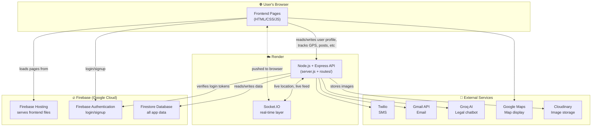
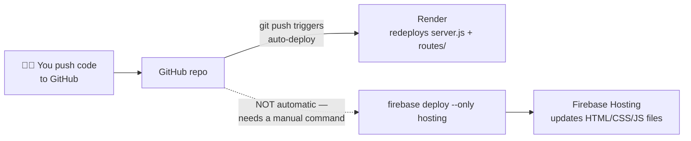
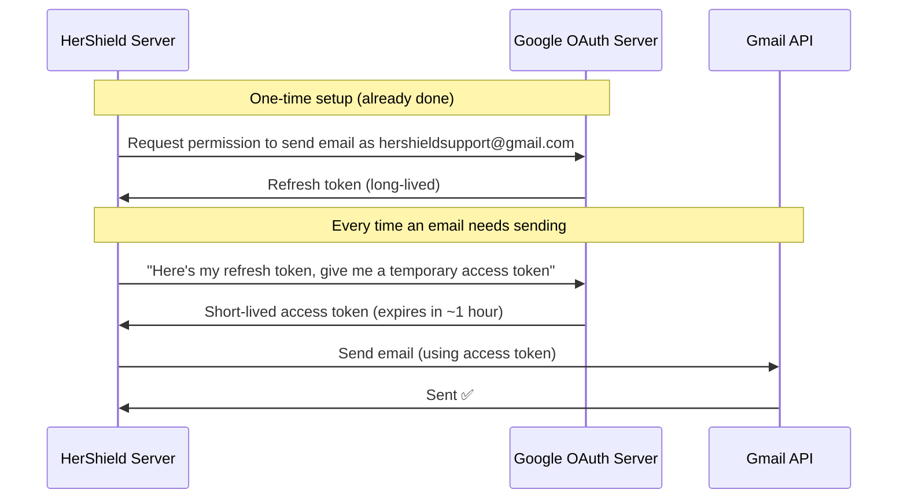
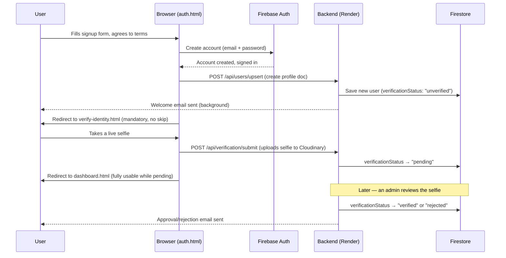
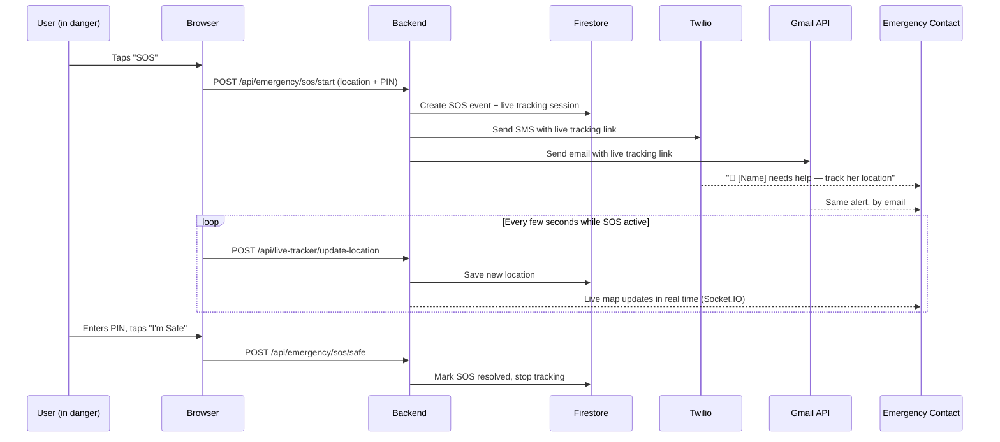

# HerShield — Project Overview

A complete, plain-language explanation of what this project is, what it's built with, why each piece was chosen, and how everything connects — including the real incidents this project has hit and how they were fixed. Written so you can present this project to anyone and answer follow-up questions confidently.

---

## Table of Contents

1. [What is HerShield?](#1-what-is-hershield)
2. [Tech Stack at a Glance](#2-tech-stack-at-a-glance)
3. [High-Level Architecture](#3-high-level-architecture)
4. [Frontend — What & Why](#4-frontend--what--why)
5. [Backend — What & Why](#5-backend--what--why)
6. [Why Two Separate Deployments](#6-why-two-separate-deployments-firebase-hosting--render)
7. [Firebase — Where It's Used, and Why](#7-firebase--where-its-used-and-why)
8. [Cloudinary — File Storage](#8-cloudinary--file-storage)
9. [OAuth — Two Different Uses](#9-oauth--what-it-is-and-the-two-different-ways-its-used-here)
10. [Every Feature — What & Built With](#10-every-feature--what-it-does-and-what-its-built-with)
11. [Key Workflows, Step by Step](#11-key-workflows-step-by-step)
12. [Security Measures in Place](#12-security-measures-in-place)
13. [Full Technology Glossary](#13-full-technology-glossary)
14. [Environment Variables](#14-environment-variables-whats-configured-not-the-actual-secrets)
15. [Incident History — What Broke, Why, and How It Was Fixed](#15-incident-history--what-broke-why-and-how-it-was-fixed)
16. [One-Paragraph Summary](#16-one-paragraph-summary-you-can-say-out-loud)

---

## 1. What is HerShield?

HerShield is a **women's safety web app**. A user can:
- Send an **SOS emergency alert** with live GPS location to her emergency contacts.
- Share a **live tracking link** while traveling so trusted contacts can watch her location in real time.
- View a **safety map** showing risky areas reported by the community.
- Post in a **community feed** to share safety tips, experiences, and incident reports.
- Chat with an **AI legal-help assistant** (LexaShield) for guidance on harassment, assault, and related legal topics.
- Get her account **verified** (a selfie + admin review) so the platform stays women-only.

An **admin panel** lets a HerShield operator manage users, review verifications, moderate community posts, broadcast safety alerts, and monitor SOS/incident activity.

---

## 2. Tech Stack at a Glance

| Layer | Technology | Role |
|---|---|---|
| **Frontend** | Plain HTML + CSS + JavaScript (no framework), Bootstrap 5 | Every page a user sees |
| **Backend** | Node.js + Express | The API server — all business logic |
| **Database** | Firebase Firestore (NoSQL) | Stores users, posts, incidents, SOS events, admin logs |
| **File storage** | Cloudinary | Verification selfies, community post images, profile avatars |
| **Authentication** | Firebase Authentication | User login/signup (email+password and Google) |
| **Real-time updates** | Socket.IO | Live location updates, live community feed, admin "Live" indicator |
| **Email** | Gmail API (OAuth2) | Welcome emails, SOS alerts, verification notifications |
| **SMS** | Twilio | SMS alerts to emergency contacts |
| **AI chatbot** | Groq (Llama 3.3 70B) | LexaShield legal-help assistant |
| **Maps** | Google Maps JavaScript API | Safety map, location picking |
| **Hosting (frontend)** | Firebase Hosting | Serves all the HTML/CSS/JS files |
| **Hosting (backend)** | Render | Runs the Node.js server 24/7 |

> **One important habit to know about this project**: the frontend and backend are deployed to two *different* places (Firebase Hosting and Render). They are two separate deployments that must both be updated when relevant files change. See [Section 6](#6-why-two-separate-deployments-firebase-hosting--render).

> **A second important habit**: "Firebase" and "Google Cloud" are the same underlying platform — a Firebase project *is* a Google Cloud project. This matters because a billing problem on the Google Cloud side (see [Section 15.3](#153-the-firebase-storage-billing-delinquency-incident)) can silently break a Firebase product (Storage) while leaving other Firebase products (Firestore, Auth, Hosting) completely unaffected, because only some Google Cloud products require an active billing account.

---

## 3. High-Level Architecture



**Read it like this:** the user's browser only ever talks to two places — **Firebase** (for login and loading pages) and **Render** (for everything the app *does* — sending an SOS, saving a post, tracking location). Firebase itself never talks to Twilio/Gmail/Groq/Cloudinary — only the Render backend does that, because those all require secret API keys that must never be visible in browser code.

> **Note:** Firebase Storage used to hold these images. Its Google Cloud billing account went delinquent and couldn't be reopened, so image storage was migrated to Cloudinary. Full story in [Section 15.3](#153-the-firebase-storage-billing-delinquency-incident) and [15.4](#154-the-cloudinary-migration). Firestore, Auth, and Hosting are separate products that don't need a billing account and were never affected.

---

## 4. Frontend — What & Why

**Technology:** Plain HTML, CSS, and JavaScript. No React, Vue, or Angular. Bootstrap 5 is used for layout/styling components, Font Awesome for icons.

**Why no framework?** For a project this size, plain JavaScript keeps things simple to read, debug, and deploy — there's no build step (no `npm run build`, no bundler). You edit an `.html` file and refresh the browser. This trades off some code reuse (there is some duplication across pages) for zero tooling complexity, which is a reasonable choice for a hackathon-scale project maintained by a small team.

**The live, actually-used pages** (all in the project root):

| Page | Purpose |
|---|---|
| `index.html` | Landing page |
| `auth.html` | Login / Sign up / password recovery |
| `verify-identity.html` | Mandatory selfie verification (shown right after signup) |
| `dashboard.html` | Main hub after login — SOS button, profile, quick links |
| `live-tracker.html` | Start/view a live location-tracking session |
| `safety-map.html` | Map of reported unsafe areas |
| `community.html` | Community post feed |
| `admin-login.html` / `admin-dashboard.html` | Admin panel |

Two shared JavaScript files are loaded on almost every page:
- **`firebase-auth.js`** — wraps Firebase Authentication (login, signup, Google sign-in, logout, session state). Also caches the user's avatar URL in `localStorage` (keys `hershield_user_avatar` / `hershield_user_avatar_owner`) so it doesn't have to be re-fetched on every page load — see [Section 15.5](#155-the-avatar-dual-source-bug) for a real bug this caching caused.
- **`navigation.js`** — the shared sidebar/navigation bar, plus the "edit profile" panel logic (including profile-picture upload) used on every page.

> **Dead code note (cleaned up):** this project used to have a large amount of orphaned/duplicate frontend code sitting alongside the live pages — a stale duplicate `public/` folder (23 files, not deployed since `firebase.json` explicitly excludes `public/**` from Hosting and instead serves the repo root directly), an abandoned `functions/` Firebase Cloud Functions attempt, orphaned duplicate HTML files (`live-tracker1.html`, `safety-map.html.bak`, `live-tracker.html.zip`), and stray non-web files (`Coloum.py`, `report_routes.py`, `tempCodeRunnerFile.py`, `Button.js`). All of this was removed — see [Section 15.2](#152-dead-code-cleanup) for the full list. Two more unreferenced files were spotted afterward and are still sitting at the repo root awaiting cleanup: **`report_button.html`** and **`safetymap.html`** (note the missing hyphen — not the same file as the live `safety-map.html`).
>
> **Unrelated sibling folders** at the repo root — `Safety Map/`, `Sheherhackathon/`, `VDIT3/` — are separate, unrelated projects that happen to live in the same parent directory. They are explicitly excluded from Firebase Hosting's deploy (`firebase.json`'s `ignore` list) and are not HerShield code. Left in place intentionally (not this project's call to delete another project's files).

---

## 5. Backend — What & Why

**Technology:** Node.js running an Express.js web server (`server.js`).

**Why Express?** It's the most widely used Node.js web framework — minimal, well-documented, and every teammate can find help for it easily. It handles routing (which URL does what), middleware (security, rate limiting, logging), and serving the frontend files.

**Folder structure:**

```
server.js              ← the entry point: sets up Express, security, rate limits, mounts every route file
routes/                ← one file per feature area — each defines the API endpoints for that feature
  ├─ users.js               (signup/login sync, profile, POST /avatar — profile picture upload)
  ├─ emergencyLite.js       (SOS start/safe/history)
  ├─ liveTracker.js         (live location tracking sessions)
  ├─ community.js           (community posts, likes, alerts)
  ├─ safety.js / safetyLocations.js  (safety map data, incident reports)
  ├─ verification.js        (selfie upload + status)
  ├─ legalChat.js           (LexaShield AI chatbot)
  ├─ admin.js               (everything the admin panel calls)
  └─ trackingLite.js        (legacy/simple tracking, kept for compatibility)
services/              ← reusable logic shared across routes (not tied to one URL)
  ├─ firestoreRepository.js (every Firestore read/write goes through here)
  ├─ cloudinaryService.js   (uploads/deletes/downloads images — see Section 8)
  ├─ emailService.js        (sends email via Gmail API)
  ├─ smsService.js / whatsappService.js  (Twilio SMS; WhatsApp is mock-mode only, never finished)
  ├─ legalChatService.js    (talks to the Groq AI API)
  ├─ userNotifications.js   (builds the welcome/approved/rejected/deactivated emails)
  ├─ sanitize.js            (strips HTML from user input, prevents XSS)
  ├─ geocoding.js           (reverse-geocodes GPS coordinates to an address)
  ├─ safetyAnalytics.js     (safety map data aggregation)
  └─ verificationRetention.js (auto-deletes old verification selfies after 90 days)
middleware/            ← code that runs before a request reaches its route
  ├─ requireAuth.js         (checks a real Firebase login token — used for verification/avatar uploads)
  ├─ adminAuth.js           (checks the admin's JWT token)
  └─ loginThrottle.js       (slows down repeated failed admin login attempts)
config/                ← one-time setup code (Firestore connection, URL helpers)
```

**Why one file per feature (`routes/`)?** So a teammate looking for "how does SOS work" can go straight to `routes/emergencyLite.js` instead of hunting through one giant file.

---

## 6. Why Two Separate Deployments (Firebase Hosting + Render)?

This is the single most important thing to understand about how this project is deployed.



- **Render** hosts the actual backend server (`server.js` and everything in `routes/`, `services/`, etc.). It auto-redeploys every time you `git push` to the `main` branch. A redeploy can also be triggered manually by saving a change in Render's Environment Variables dashboard, without any code push — worth knowing, because that means "I updated an env var" and "my new code is live" are two *different* events that don't always happen together.
- **Firebase Hosting** hosts the static frontend files (every `.html`, `.js`, `.css`). It does **not** auto-deploy on `git push` — you must run `firebase deploy --only hosting` yourself after any frontend change.

**Why split them at all, instead of one host doing both?** Firebase Hosting is extremely good (and free) at serving static files fast via a global CDN, but it cannot run a long-lived Node.js server with Socket.IO. Render is built for exactly that — a persistent server process — but isn't as optimized for serving lots of small static files. Using each for what it's best at is a common, sensible pattern.

**The practical consequence:** if you only change a backend file (something in `routes/`, `server.js`) and push to GitHub, that's enough — Render handles it. If you change a frontend file (any `.html`, `firebase-auth.js`, `navigation.js`), you **must also run the Firebase deploy command**, or your users will keep seeing the old version.

---

## 7. Firebase — Where It's Used, and Why

Firebase is a suite of backend tools made by Google. This project uses **two** parts of it today (it used to be three — Firebase Storage was the third, until it was migrated off; see [Section 8](#8-cloudinary--file-storage) and [Section 15.3](#153-the-firebase-storage-billing-delinquency-incident)):

### 7a. Firebase Authentication
**What:** Handles user login/signup (email+password, and "Sign in with Google").
**Why:** Building your own secure login system (password hashing, session tokens, password reset emails, protecting against brute-force attacks) is a lot of work to get right, and getting it *wrong* is a serious security risk. Firebase Auth is a battle-tested, free service built by Google specifically for this — it's one of the "trusted authentication provider" choices recommended for exactly this reason (avoids custom-auth pitfalls like session hijacking).

**A detail worth knowing:** a Firebase Auth user record carries its own `photoURL` field, which is **separate** from the `profilePicture` field this app stores in its own Firestore user document. The two can drift out of sync — see the real bug this caused in [Section 15.5](#155-the-avatar-dual-source-bug).

### 7b. Firestore (the database)
**What:** A NoSQL, document-based database. Every user, community post, SOS event, incident report, and admin audit log is a "document" inside a "collection" (Firestore's version of a table).
**Why:** No servers to manage, scales automatically, and integrates natively with Firebase Auth (a document can be keyed directly by the user's login ID). All reads/writes happen through one file, `services/firestoreRepository.js`, so the rest of the codebase never talks to Firestore directly — it calls simple functions like `usersFindById(id)`.

> **Side note found during this project's development:** the codebase also has `mongoose`/MongoDB configured in `package.json`, but it is **not actually used** — confirmed via the `/api/health` endpoint, which reports `mongo: { status: "not_used" }`. Firestore is the one real database. This is worth knowing so nobody assumes MongoDB is doing anything.

**Firestore does *not* require a billing account** to use at normal, small-app volume (the "Spark" free plan covers it with generous daily quotas) — this is why Firestore kept working perfectly throughout the entire Firebase Storage billing incident described in Section 15.

---

## 8. Cloudinary — File Storage

**What:** A third-party media (image/video) hosting service. It stores every uploaded image in this app: verification selfies, community post images, and profile avatars.

**Why Cloudinary, and why not Firebase Storage anymore?** This project originally used Firebase Storage for exactly this. Firebase Storage requires the project's Google Cloud **billing account** to be active (the "Blaze" pay-as-you-go plan) — even if actual usage always stays inside the free tier, a live, non-delinquent billing account must be attached. This project's billing account went delinquent over an unpaid balance of **₹8.36**, and reactivating it wasn't possible because the billing UI enforces a **₹500 minimum payment** — see the full incident in [Section 15.3](#153-the-firebase-storage-billing-delinquency-incident). Rather than depend on any billing account at all going forward, image storage was migrated entirely to Cloudinary, which has a genuinely free tier (25GB) that never requires a card. Full migration details in [Section 15.4](#154-the-cloudinary-migration).

**How it's used — `services/cloudinaryService.js`:**

| Function | What it does |
|---|---|
| `uploadImage(buffer, { publicId, type })` | Uploads a file buffer to Cloudinary under a given ID |
| `deleteImage(publicId, { type })` | Deletes an image (used on user deletion and the 90-day selfie purge) |
| `downloadAuthenticated(publicId)` | Server-side-only download of a private ("authenticated") image, using a freshly signed URL |
| `isConfigured()` | Checks the 3 required env vars are set — lets routes fail gracefully (503) instead of crashing if not |

**Two delivery types, matching exactly what each feature needs:**

| Delivery type | Used for | Behavior |
|---|---|---|
| `upload` (public) | Community post images, profile avatars | Reachable by anyone via a plain `https://res.cloudinary.com/...` URL — same visibility as before |
| `authenticated` (private) | Verification selfies | **Not** reachable via a guessable public URL. Only fetchable server-side using a signature generated from the API secret. Preserves the exact same "admin-eyes-only" privacy the old Firebase Storage setup had for selfies. |

**Where each upload happens:**

| Route | Uploads to | Delivery type |
|---|---|---|
| `POST /api/community/posts/upload` | `community-posts/...` | `upload` (public) |
| `POST /api/users/avatar` | `avatars/{uid}/...` | `upload` (public) |
| `POST /api/verification/submit` | `verification-selfies/{uid}_...` | `authenticated` (private) |

The verification-selfie's Cloudinary **public_id** is stored in the exact same Firestore field the old GCS path used to live in (`user.verificationSelfiePath`) — the field name was kept as-is to avoid a wider schema change; only what it *contains* changed.

---

## 9. OAuth — What It Is, and the Two Different Ways It's Used Here

### What is OAuth, in plain terms?

OAuth ("Open Authorization") is a standard way for one app to be granted **limited permission** to act on your behalf with another service — **without ever handing over your actual password**. Instead of typing your Google password into HerShield directly, you're redirected to Google's own login page, you approve a specific, limited request ("this app wants to send email as you" or "this app wants to know your name and email"), and Google hands back a special token that only allows *that* specific thing.

Think of it like a hotel key card instead of your house key: it opens exactly the rooms you're allowed into, for a limited time, and can be canceled without you having to change your actual house lock.

### Use #1 — "Sign in with Google" (user-facing)

When a user clicks "Sign in with Google" on the login page, this is OAuth in its most common form: the user approves HerShield seeing their name/email, and Firebase Authentication handles the entire exchange. This is a **one-time approval per user** and is what most people mean when they hear "OAuth login."

### Use #2 — Gmail API OAuth (server-to-server email sending)

This is a completely different, less common use of OAuth: the HerShield **server itself** is authorized to send emails through one specific Gmail account (`hershieldsupport@gmail.com`), without needing that account's actual password stored anywhere.

**Why not just use a normal SMTP email library?** Render (the hosting provider) **blocks all outbound SMTP traffic** (the traditional way apps send email, e.g. `smtp.gmail.com`) — confirmed directly by testing that both port 465 and 587 simply time out from Render, while working fine from a local machine. The Gmail **API** (a plain HTTPS web request, not SMTP) is not blocked, so it's the only path that works from Render.

**How the credential works:**
- `GMAIL_OAUTH_CLIENT_ID` + `GMAIL_OAUTH_CLIENT_SECRET` — identify the HerShield app itself to Google (not secret to a specific run, they don't expire).
- `GMAIL_OAUTH_REFRESH_TOKEN` — a long-lived credential proving the Gmail account already approved this app. The server uses this to fetch a short-lived access token automatically every time it needs to send an email.

**A real issue this project hit** (full incident write-up in [Section 15.1](#151-the-gmail-oauth-token-expiry-incident)): while the Google Cloud project's OAuth consent screen was still in **"Testing"** publishing status, Google auto-expires refresh tokens after just 7 days — meaning email silently stopped working every week until someone regenerated the token. The project's OAuth consent screen has since been **published to Production**, which removes that 7-day expiry — the refresh token now only needs replacing if the Gmail password changes, access is manually revoked, or it goes fully unused for 6+ months.



---

## 10. Every Feature — What It Does and What It's Built With

### 🔐 Authentication & Onboarding
- **Signup / Login** — email+password or Google, via Firebase Authentication.
- **Mandatory identity verification** — right after signup, every *new* account is required to take a live selfie (camera only, no gallery uploads) before reaching the dashboard. This gets reviewed by an admin (approve/reject). Existing accounts created before this rule was added are not retroactively forced through it.
  - *Tech:* Firebase Auth (identity) + Cloudinary, `authenticated` delivery type (selfie file — private) + Firestore (`verificationStatus` field: `unverified` → `pending` → `verified`/`rejected`).
- **Welcome / status-change emails** — sent automatically on signup, and when an admin approves, rejects, or deactivates an account.
  - *Tech:* Gmail API (`services/emailService.js`, `services/userNotifications.js`).

### 🆘 Emergency SOS
- User triggers an SOS with one tap; her live GPS location and a live-tracking link are sent to her emergency contacts by **SMS and email**, with an auto-expiring timer.
- A 4-digit PIN is required to mark yourself "safe" again (so someone else can't falsely cancel your alert).
  - *Tech:* Express routes (`routes/emergencyLite.js`), Twilio (SMS), Gmail API (email), Firestore (SOS event history), Socket.IO (real-time updates to anyone watching).

### 📍 Live Tracking
- Share a live-updating location link with trusted contacts while traveling (independent of an active SOS).
  - *Tech:* `routes/liveTracker.js`, browser Geolocation API (`navigator.geolocation`) on the frontend, Socket.IO to push updates to viewers in real time.

### 🗺️ Safety Map
- Visual map showing areas flagged as risky by community incident reports, color-coded by severity.
  - *Tech:* Google Maps JavaScript API (display), `routes/safetyLocations.js` + `routes/safety.js` (data).

### 💬 Community Feed
- Users post safety tips, experiences, or incident reports, optionally with a photo; other users can like posts.
- Public views (community feed) **anonymize** the reporter's name to "HerShield User" — only admins can see who actually reported an incident.
  - *Tech:* `routes/community.js`, Cloudinary (`upload`/public delivery for post images), Firestore.

### 👤 Profile / Avatar
- Users can set a profile picture, either uploaded from a device or a manually entered image URL.
  - *Tech:* `POST /api/users/avatar` (backend endpoint, Firebase-ID-token protected) uploads to Cloudinary and returns a URL, which `navigation.js` then saves via `PUT /api/users/profile/:userId`. Uploading through the backend (rather than the browser talking to Cloudinary directly) keeps the Cloudinary API secret out of client-side code.

### ⚖️ LexaShield (AI legal chatbot)
- A chat assistant that answers questions about harassment, assault, filing an FIR, and related legal topics in India.
  - *Tech:* Groq's hosted Llama 3.3 70B model (`services/legalChatService.js`), its own dedicated rate limit to control API cost.

### 🛠️ Admin Panel
- Manage users (view/deactivate/delete), review pending verifications (approve/reject with a reason), moderate community posts and safety alerts, view SOS/incident history, broadcast a safety alert to all users, upload bulk safety-location data via CSV, view an audit log of every admin action, and a live/dark-mode-aware dashboard UI.
  - *Tech:* Its own login system (`bcryptjs` + `jsonwebtoken`, not Firebase Auth — chosen so a single hardcoded operator account doesn't need a full multi-user Firebase project), `routes/admin.js`, its own light/dark theme toggle.

---

## 11. Key Workflows, Step by Step

### Signup → Mandatory Verification



> **Note on `POST /api/users/upsert`:** this runs on *every* sign-in, not just signup, and syncs the Firebase Auth `photoURL` into Firestore's `profilePicture` field whenever they differ. This is convenient for keeping the two in sync, but it also means fixing a bad avatar URL in Firestore alone doesn't stick if Auth's own `photoURL` is still bad — the next login silently overwrites the fix. See [Section 15.5](#155-the-avatar-dual-source-bug) for the real incident this caused.

### SOS Emergency Alert



---

## 12. Security Measures in Place

- **Server-side validation on every input** — every route validates and sanitizes incoming data (`express-validator` + `sanitize-html`), so the client can never be trusted to self-police.
- **Rate limiting**, tuned per area:
  - General API traffic: 500 requests / 15 minutes per IP.
  - Admin panel: 120 requests / minute (separate from general traffic).
  - **Emergency SOS / Live Tracking: 300 requests / minute**, deliberately generous and isolated from the general limiter — an active emergency session sends frequent location updates and must never be silently throttled.
- **Passwords are never stored in plain text.** Admin password uses `bcryptjs` hashing; regular users authenticate entirely through Firebase Auth, which never exposes raw passwords to this codebase at all.
- **Generic login error messages** ("Incorrect email or password") — prevents an attacker from learning whether an email address exists in the system.
- **Progressive delay on repeated failed admin logins** (`middleware/loginThrottle.js`) — slows down brute-force attempts without permanently locking out a legitimate admin.
- **Selfie storage is private** — verification selfies use Cloudinary's `authenticated` delivery type, not reachable via any public URL, only through an authenticated admin-only route (`GET /api/admin/verifications/:userId/selfie`), which fetches the bytes server-side with a signed URL and streams them to the admin's browser. The Cloudinary API secret never leaves the server.
- **Auto-deletion of old verification selfies** after 90 days (`services/verificationRetention.js`) — deletes from Cloudinary and clears the pointer on the user doc, regardless of the verification outcome.
- **Cloudinary API secret never reaches the browser** — profile-picture uploads go through a backend endpoint (`POST /api/users/avatar`) rather than the browser calling Cloudinary directly, even though avatars themselves are public once uploaded.

---

## 13. Full Technology Glossary

| Technology | Category | What it's for here |
|---|---|---|
| **Node.js** | Runtime | Runs the JavaScript backend server |
| **Express.js** | Backend framework | Defines API routes, middleware |
| **Firebase Authentication** | Auth | User login/signup, Google sign-in |
| **Firebase Firestore** | Database | Stores all app data (users, posts, SOS events, logs) |
| **Cloudinary** | File storage | Verification selfies, community images, profile avatars (replaced Firebase Storage — see Section 15.3/15.4) |
| **Firebase Hosting** | Frontend hosting | Serves all HTML/CSS/JS files |
| **Render** | Backend hosting | Runs the Express server continuously |
| **Socket.IO** | Real-time communication | Live location updates, live community feed |
| **Twilio** | SMS | Sends SOS/alert text messages |
| **Gmail API (googleapis)** | Email | Sends all app emails, via OAuth2 (not SMTP) |
| **Groq (groq-sdk)** | AI | Powers the LexaShield legal chatbot (Llama 3.3 70B) |
| **Google Maps JavaScript API** | Maps | Displays the safety map |
| **Bootstrap 5** | CSS framework | Page layout and styling components |
| **Font Awesome** | Icons | Icon set used throughout the UI |
| **bcryptjs** | Security | Hashes the admin password |
| **jsonwebtoken (JWT)** | Security | Admin login session tokens |
| **express-validator** | Security | Validates/rejects malformed input server-side |
| **sanitize-html** | Security | Strips HTML/script tags from free-text input (XSS defense) |
| **express-rate-limit** | Security | Throttles excessive requests per IP |
| **helmet** | Security | Sets protective HTTP security headers (CSP is currently disabled — `contentSecurityPolicy: false` in `server.js`) |
| **multer** | File uploads | Parses multipart form uploads (selfies, post images, avatars) in memory before they go to Cloudinary |
| **csv-parser** | Data import | Reads bulk safety-location CSV uploads in the admin panel |
| **morgan** | Logging | Logs every HTTP request in the server console |
| **compression** | Performance | Compresses HTTP responses |
| **cors** | Security | Controls which origins can call the API |
| **dotenv** | Config | Loads `.env` file variables locally |

**Present in the project but *not* actually used today** (worth knowing so it isn't mistaken for live infrastructure):
- `mongoose` / `connect-mongo` / MongoDB — configured, but Firestore is the real database (`/api/health` reports MongoDB as `not_used`).
- `nodemailer` — installed, but email actually sends through the Gmail API directly (`googleapis`), not through nodemailer's SMTP transport, because Render blocks SMTP.
- `nedb-promises` — an embedded local database package, not wired into the live data path.
- `whatsappService.js` — wired up and called from the SOS flow, but every function returns a mock `{ success: true, mock: true }` response with a `TODO` comment; no real WhatsApp Business API call is implemented.

---

## 14. Environment Variables (What's Configured, Not the Actual Secrets)

The backend needs these categories of configuration (in Render's environment variables, and mirrored in a local `.env` file for local development):

| Category | Variables (names only) |
|---|---|
| Server | `PORT`, `NODE_ENV`, `TRUST_PROXY` |
| URLs | `APP_URL` (Render backend), `FRONTEND_URL` (Firebase Hosting) |
| Firebase (client-side config) | `FIREBASE_API_KEY`, `FIREBASE_AUTH_DOMAIN`, `FIREBASE_PROJECT_ID`, `FIREBASE_STORAGE_BUCKET`*, etc. |
| Firebase (server-side admin) | `FIREBASE_SERVICE_ACCOUNT_PATH` (a private key file) |
| Twilio | `TWILIO_ACCOUNT_SID`, `TWILIO_AUTH_TOKEN`, `TWILIO_PHONE_NUMBER` |
| Email (Gmail API OAuth2) | `EMAIL_USER`, `GMAIL_OAUTH_CLIENT_ID`, `GMAIL_OAUTH_CLIENT_SECRET`, `GMAIL_OAUTH_REFRESH_TOKEN` |
| **File storage (Cloudinary)** | `CLOUDINARY_CLOUD_NAME`, `CLOUDINARY_API_KEY`, `CLOUDINARY_API_SECRET` |
| Admin panel | `ADMIN_EMAIL`, `ADMIN_PASSWORD_HASH`, `ADMIN_JWT_SECRET` |
| AI chatbot | `GROQ_API_KEY`, `GROQ_MODEL` |
| Rate limiting | `RATE_LIMIT_WINDOW_MS`, `RATE_LIMIT_MAX_REQUESTS` |
| Maps | `GOOGLE_MAPS_API_KEY` |

<sub>* `FIREBASE_STORAGE_BUCKET` is left in place for the client-side Firebase config object but is no longer read by any upload/download code path — it's a harmless leftover from before the Cloudinary migration, not a required variable anymore.</sub>

⚠️ A recurring gotcha on this project: **Render's environment variables and the local `.env` file are two separate places** — updating one does not update the other. Several bugs this project hit (missing storage bucket, missing admin email, expired Twilio/Gmail credentials, the Cloudinary rollout itself) came down to a value being set locally but never added to Render, or vice versa. A related gotcha: saving an env var change in Render triggers a redeploy of the *current* code — if you also have a code change waiting to be merged, the env var alone won't make that code live.

---

## 15. Incident History — What Broke, Why, and How It Was Fixed

This section is a chronological record of real problems this project has hit, kept here because "what changed and why" is exactly the kind of context that gets lost once an issue is fixed and forgotten.

### 15.1. The Gmail OAuth Token Expiry Incident

**Symptom:** SOS/notification emails silently stopped sending.

**Diagnosis:** Querying Google's OAuth server directly with the stored refresh token returned `invalid_grant: "Token has been expired or revoked."`

**Root cause:** The Google Cloud project's OAuth consent screen was still in **"Testing"** publishing status. Google auto-expires refresh tokens after 7 days for any app in that status, regardless of how actively the token is used.

**Fix:**
1. Generated a new refresh token via Google's OAuth Playground.
2. Updated `GMAIL_OAUTH_REFRESH_TOKEN` in both the local `.env` and Render's environment variables (two separate places that both needed updating — see Section 14's gotcha).
3. Verified the fix by sending a real test email through the live Gmail API path before considering it done.
4. **Fixed the actual root cause**, not just the symptom: published the OAuth consent screen to "Production" in Google Cloud Console, which removes the 7-day auto-expiry entirely. The app being "unverified" for the sensitive `gmail.send` scope doesn't block anything here since the only account signing in is the app's own sending address.

A full step-by-step runbook for regenerating this token if it ever happens again lives in [`GMAIL_OAUTH_REFRESH_TOKEN_UPDATE.md`](GMAIL_OAUTH_REFRESH_TOKEN_UPDATE.md) at the repo root.

### 15.2. Dead Code Cleanup

A separate pass through the repository found a substantial amount of code that was never actually live. Everything below was verified unreferenced (via `grep` across the whole live codebase, and cross-checked against `firebase.json`'s hosting `ignore` list) before removal — 41 files, ~22,000 lines:

| Removed | What it was |
|---|---|
| `public/` (entire directory, 23 files) | A stale duplicate of the whole site. Firebase Hosting serves from the repo root (`"public": "."` in `firebase.json`), and `public/**` was explicitly excluded from deployment — this folder was never actually served. Confirmed stale by file modification dates (its `index.html` was months older than the live root copy). |
| `functions/` (entire directory) | An abandoned Firebase Cloud Functions attempt with its own duplicate `routes/`, `services/`, `models/`, `config/`. No `"functions"` block existed in `firebase.json`, and it was also in the hosting ignore list. |
| `live-tracker1.html`, `safetymap.html`, `report_button.html` (inside the old `public/`), `safety-map.html.bak`, `live-tracker.html.zip` | Orphaned duplicate/backup files with zero references anywhere in live code. |
| `Coloum.py`, `report_routes.py`, `tempCodeRunnerFile.py`, `Button.js` | Stray non-web cruft at the repo root. |

**Left alone, on purpose:** `Safety Map/`, `Sheherhackathon/`, `VDIT3/` — these are separate, unrelated projects sitting in the same parent folder, not HerShield code, and not this project's decision to delete.

**Found afterward, not yet cleaned up:** root-level `report_button.html` and `safetymap.html` (distinct from the ones already removed from inside `public/`) are also unreferenced anywhere and are candidates for the same cleanup treatment.

Verification before removal: `server.js` syntax check passed, and every route module the server actually `require()`s still loaded cleanly afterward.

### 15.3. The Firebase Storage Billing Delinquency Incident

**Symptom:** Profile pictures and community post images stopped saving, and *previously working* images started showing as broken.

**Diagnosis, step by step:**
1. Firestore reads worked fine — ruled out "the whole backend is down."
2. Directly querying Cloud Storage for an existing, previously-working image URL returned `403: "The billing account for the owning project is disabled in state delinquent"` — for both public URL access *and* authenticated Admin SDK access. This ruled out a permissions/config bug; the entire Storage API was locked out project-wide.
3. Running `gcloud billing accounts list` (read-only) showed **all 4 Google Cloud billing accounts** on the account were `OPEN: False` — including the one linked to this project. A closed billing account blocks all usage regardless of any remaining free-credit balance, because credits can only be spent through an *open* account.
4. The user had ~1,600 unused Google Cloud credits sitting on these closed accounts — confirmed unusable for exactly that reason, not a bug on the app's side.
5. Reopening the account required paying off an outstanding balance of **₹8.36** — but the billing payment UI enforced a **₹500 minimum payment**, making a direct reactivation impractical.
6. A separate underlying constraint: even with an open, non-delinquent billing account, Firebase Storage requires the **Blaze** (pay-as-you-go) plan — it has no free-tier-only option, unlike Firestore. Since the goal was to depend on zero billing accounts going forward, this ruled out staying on Firebase Storage even if the ₹8.36 had been payable.

**Data recovery attempt:** before deciding to write off the then-inaccessible files, an attempt was made to export them. `gsutil ls` (metadata listing) still worked even with billing delinquent, so the exact contents of the bucket could be inventoried: 4 community-post images, 3 avatars, 7 verification selfies. Actually **downloading** any of the bytes — tried via both the Firebase Admin SDK and `gsutil cp` with the account owner's own credentials — failed identically with the same billing error. The files weren't deleted, just completely inaccessible by any method available, with no code-side workaround possible.

**Impact assessment before deciding to proceed:**
- Only 2 of the 4 community-post images were referenced by a still-live post (the other 2 belonged to already-deleted/edited posts).
- Of the 7 verification selfies: 4 belonged to already-`verified` users and 1 to an already-`rejected` user — losing those photos has **zero effect**, since this app's own 90-day retention policy already deletes selfies post-decision while keeping the verification status intact. Only **2** belonged to users still in `pending` status, who would need to be asked to resubmit.
- All 3 avatars degrade gracefully to a generated placeholder image (the same fallback already used for brand-new signups), not a hard failure.

**Decision:** write off the 12 inaccessible files (small, bounded, mostly zero real-world impact) and migrate all image storage off Firebase Storage entirely — see Section 15.4.

### 15.4. The Cloudinary Migration

Full technical details of what Cloudinary is and how it's used are in [Section 8](#8-cloudinary--file-storage). This entry covers the migration process itself.

**Why Cloudinary specifically:** a genuinely free tier (25GB) that never requires a payment method on file, unlike Firebase Storage's Blaze-plan requirement.

**What changed, file by file:**

| File | Change |
|---|---|
| `services/cloudinaryService.js` (new) | Wraps the Cloudinary Node SDK: `uploadImage`, `deleteImage`, `downloadAuthenticated`, `isConfigured` |
| `routes/community.js` | Post-image upload now goes to Cloudinary (`upload`/public), same `imageUrl` contract as before |
| `routes/verification.js` | Selfie upload now goes to Cloudinary (`authenticated`/private); `verificationSelfiePath` now stores a Cloudinary `public_id` instead of a GCS path |
| `routes/admin.js` | Selfie-streaming route and cascade user-delete now use `cloudinaryService` instead of the old GCS bucket |
| `services/verificationRetention.js` | The 90-day purge sweep now deletes from Cloudinary |
| `routes/users.js` | New `POST /avatar` endpoint (Firebase-ID-token protected) — uploads to Cloudinary server-side so the API secret never reaches the browser |
| `navigation.js` | Avatar upload now `POST`s to the new backend endpoint instead of uploading client-side straight to Firebase Storage |
| `config/firestoreAdmin.js` | Removed the now-dead `getStorageBucket()` export |
| `.env.example`, `render.yaml` | Documented the 3 new `CLOUDINARY_*` env vars |

**Verification performed before shipping** (against the real, live Cloudinary account and a running local server — not just code review):
- Public upload → publicly fetchable (`200`); authenticated upload → confirmed **not** reachable via its plain URL (`404`), proving the access-control split actually works as designed.
- Full round-trip test of every changed endpoint using a throwaway Firebase Auth test user + real ID token: avatar upload (401 unauthenticated → 200 with token), verification submit (sets `pending`, confirmed via status endpoint), admin selfie streaming (401 without admin token → 200 with real image bytes), and cascade user-delete (confirmed the Cloudinary file was *actually* deleted by checking the account directly afterward, not just trusting the API response).
- All throwaway test data (test Auth user, Firestore doc, Cloudinary test assets) cleaned up afterward.
- Repeated the same verification against the **live production** Render deployment after merging, not just locally — this caught that Render's first redeploy attempt hadn't actually picked up the new code yet (confirmed by an unchanged `uptime` in `/api/health` and the old billing error still appearing), which resolved itself once the deploy actually completed.

**Data cleanup performed alongside the code change:** cleared the `imageUrl` field on the 3 Firestore community posts that pointed at now-dead image URLs (2 Firebase Storage, 1 even-older ephemeral-disk reference from before Storage was even introduced) — the posts' text content and everything else stayed intact, they just no longer show a broken image icon.

### 15.5. The Avatar Dual-Source Bug

**Symptom:** after fixing one user's dead avatar URL directly in Firestore, the profile picture was still showing broken — even after clearing the browser's `localStorage` cache (the first suspected cause) and reloading.

**Root cause:** an avatar URL actually lives in **two separate places**, not one:
1. Firestore's `profilePicture` field (the one that got fixed first).
2. Firebase **Authentication's own** `photoURL` property on the user record — set independently, at signup or via a provider like Google.

`POST /api/users/upsert` runs on **every sign-in** and copies Auth's `photoURL` into Firestore whenever the two differ. Since Auth's `photoURL` was *also* still pointing at the dead URL, every subsequent login silently overwrote the Firestore fix right back to broken — a fix that looked successful in the database but never actually stuck for the user.

**Fix:** updated **both** sources to the same working placeholder URL — Firebase Auth's `photoURL` via `admin.auth().updateUser(uid, { photoURL })`, and Firestore's `profilePicture` via the normal repository save — then re-read both back to confirm they actually persisted this time, rather than trusting the write call alone.

**Follow-up sweep:** every other user account was checked for the same dual-source drift (both their Firestore `profilePicture` *and* their Firebase Auth `photoURL`, since only the Firestore side had been checked initially). No other accounts were affected.

**Lesson for next time:** if an avatar/photo bug looks fixed in Firestore but keeps coming back after login, check Firebase Auth's own `photoURL` too — `/api/users/upsert`'s auto-sync means the two must agree, or the auth-side value will always win on the next sign-in.

---

## 16. One-Paragraph Summary You Can Say Out Loud

> "HerShield is a women's safety platform built with a plain HTML/CSS/JavaScript frontend and a Node.js/Express backend. Firebase provides our login system and our database (Firestore) — both managed, so we don't run our own database server. Image storage (selfies, post images, avatars) runs on Cloudinary rather than Firebase Storage, after Firebase Storage's billing account went delinquent and couldn't be reopened — Firestore and Auth were never affected by that, since they don't require a billing account the way Storage does. The frontend is hosted on Firebase Hosting; the backend runs continuously on Render, because Render can run a persistent server process while Firebase Hosting only serves static files. We use two different flavors of OAuth: Google Sign-In for users logging in, and a separate Gmail API OAuth credential so our *server* can send emails — the latter exists specifically because Render blocks traditional SMTP email sending. Every core safety feature — SOS, live tracking, verification, community reporting — is built on top of that same Firebase + Express foundation, with Twilio for SMS, Groq for our AI legal chatbot, Cloudinary for images, and Google Maps for the safety map."

---

*Last updated: reflects the codebase as of the Gmail OAuth production-publish fix, the dead-code cleanup (41 files removed), the full Firebase Storage → Cloudinary migration, and the Firebase-Auth/Firestore avatar dual-source fix.*
